# Actores y Modelo Operativo del Sistema — LiveBid

> **Proyecto:** LiveBid — Plataforma de Subastas en Tiempo Real con Custodia Garantizada  
> **Capa:** Análisis de Sistema · **Versión:** 3.1 (Especificación Profesional por Roles y Servicios Externos)

---

## 1. ¿Quiénes Somos como Plataforma (`LiveBid`)?

**LiveBid** es una **Plataforma Tecnológica de Subastas en Tiempo Real (Modelo Marketplace B2B2C con Custodia Escrow)**.
- **LiveBid NO es dueño de todos los bienes:** actúa como el **intermediario tecnológico y financiero neutral** que conecta a quienes desean vender activos de alto valor (**Vendedores/Consignantes**), a los profesionales acreditados que dirigen legalmente el remate (**Martilleros/Encargados**), a los compradores verificados (**Postores**) y a la administración de cumplimiento (**Administradores del Sistema**).
- **Garantía de Confianza:** Nadie puede pujar sin antes haber dejado una garantía retenida en su tarjeta mediante **Stripe (`Pre-Auth Hold`)**, y ningún lote se publica sin identificar su **imagen referencial**, su **ficha técnica/pericial** y su **encargado oficial**.

---

## 2. Matriz de Actores Humanos y Responsabilidades Exactas (`RBAC`)

| Actor | Rol en Sistema (`UserRole`) | ¿Qué realiza exactamente y qué información sube a la plataforma? |
| :--- | :--- | :--- |
| **1. Postor / Comprador** | `POSTOR` | • Se registra solicitando el rol `POSTOR` e ingresa su documento de identidad y teléfono. • Inicia sesión (`JWT`) una vez que su cuenta está `ACTIVA`. • **Autoriza su garantía con tarjeta en Stripe** (en el Frontend ingresa su tarjeta en el componente seguro de Stripe; el Backend retiene el saldo sin cobrarlo aún). • Entra a la sala en vivo, puja en tiempo real o programa una **Auto-Puja con tope máximo (`max_cap`)**. |
| **2. Vendedor / Consignante** | `VENDEDOR` | • Es el propietario o entidad consignante del bien a subastar. • Se registra solicitando el rol `VENDEDOR` y es aprobado por el `ADMIN`. • **Sube la subasta y los Detalles del Lote (`DetallesLote`):**   1. **Imagen referencial subida por él mismo** (seleccionando el archivo de foto desde su computadora/celular o mediante URL) y galería adicional.   2. **Ficha técnica y pericial:** Título, descripción, precio base, precio de reserva, ubicación física, nombre del perito tasador, certificado PDF y tabla de especificaciones. • Puede proponer o registrar los datos del encargado asignado a su remate. |
| **3. Martillero / Encargado Oficial** | `MARTILLERO` | • Es el profesional acreditado (ej. Martillero Público con registro oficial) que dirige el remate. • **Sube o actualiza su Ficha de Encargado (`EncargadoSubasta`):** Nombre oficial, cargo, número de licencia/colegiatura, teléfono/correo de contacto y resumen de experiencia. • **Controla el ciclo en vivo de la sala:** Activa la subasta (`ACTIVA`), canta la cuenta regresiva (`EN_CONTEO`: *a la una, a las dos...*) y ejecuta el cierre oficial (`CERRADA`), lo que dispara en el Backend el cobro en Stripe al ganador y la liberación de saldo a los demás. |
| **4. Administrador del Sistema** | `ADMIN` | • Es la máxima autoridad operativa de **LiveBid** (se inicializa automáticamente con `BootstrapAdmin` al arrancar el servidor). • **Gobierna Usuarios y Roles:** Revisa los usuarios recién registrados (`PENDIENTE`), verifica su identidad (`kyc_aprobado = true`), activa o suspende cuentas (`ACTIVO`, `SUSPENDIDO`, `BLOQUEADO`) y asigna los roles (`POSTOR`, `VENDEDOR`, `MARTILLERO`, `ADMIN`). • Puede crear o editar cualquier subasta, asignar un Martillero encargado, subir imágenes/detalles de lote y auditar los pagos de Stripe y la cadena criptográfica `SHA-256`. |

---

## 3. ¿Quién sube las Imágenes Referenciales y los Detalles del Bien?

Para evitar cualquier ambigüedad durante el desarrollo, el flujo de carga de información del bien subastado funciona así:

```mermaid
flowchart LR
    V["🏢 Vendedor (o Admin/Martillero)<br><i>Desde el Formulario 'Crear / Editar Lote'</i>"] -->|"1. Selecciona foto referencial<br>desde su dispositivo (o URL)"| UI["🖼️ Previsualización Instantánea<br>en el Frontend (DataURL / Storage)"]
    UI -->|"2. Completa Ficha Técnica:<br>Categoría, Ubicación, Tasación,<br>Perito y Especificaciones"| API["⚙️ PUT /api/v1/subastas/{id}/detalles-lote<br><i>Backend Go valida reglas</i>"]
    API -->|"3. Guarda en PostgreSQL 16"| DB[("🗄️ Tabla subastas<br>columna detalles_lote_json (JSONB)")]
    DB -->|"4. Se muestra en el Catálogo<br>y en la Sala en Vivo"| Postor["👤 Postor ve la foto real,<br>el peritaje y quién es el Encargado"]

    style V fill:#0F172A,stroke:#38BDF8,stroke-width:2px,color:#FFF
    style UI fill:#1E293B,stroke:#60A5FA,stroke-width:2px,color:#FFF
    style API fill:#082F49,stroke:#0EA5E9,stroke-width:2px,color:#FFF
    style DB fill:#052E16,stroke:#22C55E,stroke-width:2px,color:#FFF
    style Postor fill:#2E1065,stroke:#C084FC,stroke-width:2px,color:#FFF
```

1. **Subida por el propio usuario (`VENDEDOR`, `MARTILLERO` o `ADMIN`):** En el formulario de la plataforma, el usuario tiene un selector de archivo (`Subir imagen desde mi equipo`) además de poder pegar URLs externas.
2. **Previsualización y Almacenamiento:** Al elegir una foto de su computadora/celular, el navegador la procesa y previsualiza al instante, enviándola dentro de `imagenes_urls` en `DetallesLote` hacia PostgreSQL (`detalles_lote_json`) o hacia **Azure Blob Storage / Cloudflare CDN** en producción.

---

## 4. Sistemas Externos y División de Responsabilidades en la Pasarela de Pagos (`Stripe`)

Una pasarela de pagos moderna (**Stripe**, PayPal o Niubiz) **jamás se implementa solo en el Frontend o solo en el Backend**. Por seguridad bancaria (**norma PCI-DSS**), ambos trabajan en equipo con responsabilidades estrictamente separadas:

| Capa | ¿Qué clave usa? | Responsabilidad Estricta en el Pago con Stripe | ¿Qué NUNCA debe hacer? |
| :--- | :--- | :--- | :--- |
| **Frontend Web (`Browser SPA`)** | **Clave Pública** (`STRIPE_PUBLISHABLE_KEY` / `pk_test_...`) + `client_secret` | 1. Pedir al Backend iniciar el proceso de garantía para la subasta `X`. 2. Recibir el `client_secret` y mostrar el formulario seguro de tarjeta (Stripe Elements / Checkout). 3. Enviar los datos de la tarjeta **directamente a Stripe** para obtener la confirmación/token. | ❌ **Nunca** decide ni calcula el monto a cobrar (un usuario podría alterarlo en el navegador). ❌ **Nunca** guarda ni conoce la `STRIPE_SECRET_KEY`. |
| **Backend Go (`livebid-backend`)** | **Clave Secreta** (`STRIPE_SECRET_KEY` / `sk_test_...`) + `STRIPE_WEBHOOK_SECRET` | 1. Calcular en el servidor el monto exacto de la garantía (10% o 20% según el precio base en PostgreSQL y el riesgo IA). 2. Crear en Stripe el `PaymentIntent` con `capture_method: "manual"` (retención preventiva) y entregar solo el `client_secret` al Frontend. 3. Verificar en Stripe (o vía Webhook firmado) que la retención fue exitosa y guardar `estado = RETENIDA` en PostgreSQL. 4. Al cerrar la subasta, ordenar a Stripe **Cobrar (`Capture`)** al ganador y **Liberar (`Cancel`)** el dinero a todos los no ganadores. | ❌ **Nunca** recibe ni guarda en PostgreSQL los 16 dígitos de la tarjeta ni el código CVV (solo guarda el `payment_intent_id`, ej. `pi_3Q...`). |
