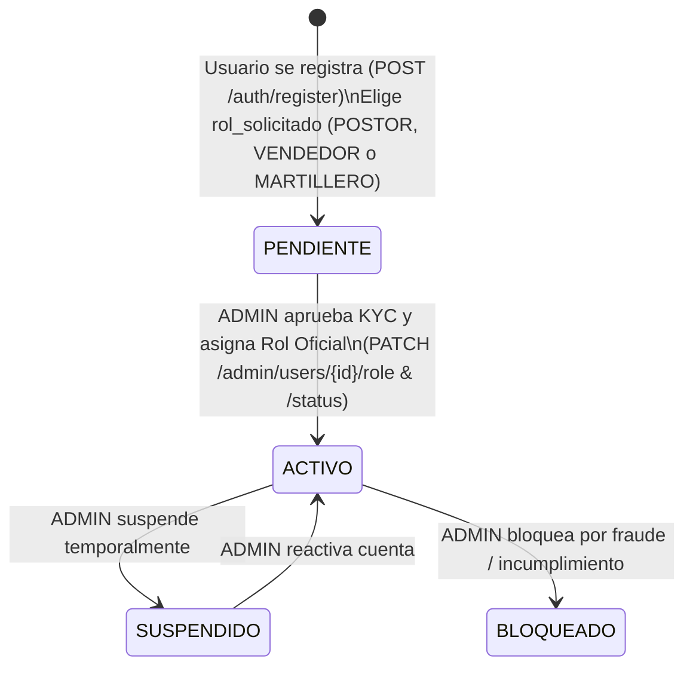
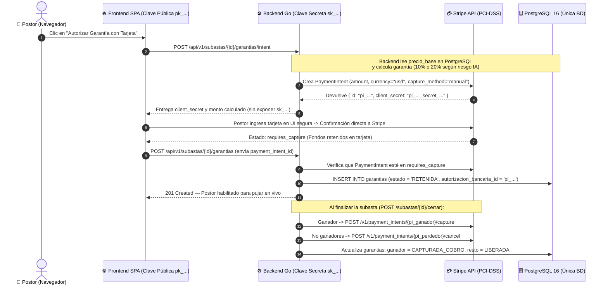

# Especificación de Requisitos Funcionales (SRS) — LiveBid

> **Proyecto:** LiveBid — Plataforma de Subastas en Tiempo Real  
> **Capa:** Análisis de Sistema · **Versión:** 3.1 (Especificación Completa por Módulo: Registro/Login/Admin, Imagen y Detalles del Lote, Pasarela Stripe Frontend+Backend, Sala en Vivo, IA y Auditoría)

---

## 1. Catálogo Maestro de Requisitos Funcionales por Módulo

| ID | Módulo del Sistema | Requisito Funcional | Prioridad |
| :--- | :--- | :--- | :---: |
| **RF-01** | **M1. Identidad, Registro y Login** | El sistema debe permitir el registro de usuarios capturando nombre, correo único, contraseña ($\ge 8$ caracteres), documento de identidad, teléfono y **rol solicitado** (`POSTOR`, `VENDEDOR`, `MARTILLERO`), almacenando la contraseña con hash `bcrypt`. | Alta |
| **RF-02** | **M1. Identidad, Registro y Login** | El sistema debe autenticar únicamente a usuarios en estado `ACTIVO` mediante `POST /api/v1/auth/login`, emitiendo un `access_token` JWT firmado (con `user_id` y `role`) y un `refresh_token` rotativo de un solo uso. | Alta |
| **RF-03** | **M1. Gobernanza y Roles (`ADMIN`)** | El sistema debe inicializar automáticamente una cuenta `ADMIN` activa (`BootstrapAdmin`) y permitir al rol `ADMIN` listar usuarios, aprobar su verificación `KYC` (`kyc_aprobado = true`), cambiar su estado (`PENDIENTE`, `ACTIVO`, `SUSPENDIDO`, `BLOQUEADO`) y asignar su rol oficial (`POSTOR`, `VENDEDOR`, `MARTILLERO`, `ADMIN`) con invalidación inmediata en caché. | Alta |
| **RF-04** | **M2. Catálogo e Imagen Referencial** | El sistema debe permitir a los roles `VENDEDOR`, `MARTILLERO` y `ADMIN` crear subastas y **subir por sí mismos la imagen referencial y galería del bien** (mediante selector de archivo desde su dispositivo o URL), junto con la ficha técnica y pericial (`DetallesLote`: categoría, ubicación, precio de reserva, perito inspector, certificado PDF y especificaciones). | Alta |
| **RF-05** | **M2. Encargado de la Subasta** | El sistema debe permitir asignar y actualizar los datos oficiales del **Encargado / Martillero de la Subasta** (`EncargadoSubasta`: `martillero_id`, nombre completo, cargo, número de licencia/colegiatura oficial, contacto y experiencia) y mostrarlos públicamente en la sala. | Alta |
| **RF-06** | **M3. Pasarela Stripe (Intención + Hold)** | El sistema debe implementar la retención de garantía dividiendo responsabilidades entre **Backend y Frontend**: el Backend calcula el monto obligatorio (10% del precio base o 20% si el riesgo IA es alto) y crea en **Stripe** un `PaymentIntent` con `capture_method: "manual"` devolviendo el `client_secret`; el Frontend captura y tokeniza la tarjeta directamente contra Stripe y confirma la retención (`estado = RETENIDA` en PostgreSQL). | Alta |
| **RF-07** | **M3. Pasarela Stripe (Liquidación y Webhook)** | Al cerrarse la subasta, el Backend debe ordenar automáticamente a **Stripe** capturar los fondos (`Capture`) del postor ganador (`CAPTURADA_COBRO`) y cancelar/liberar sin costo (`Cancel`) las retenciones de todos los demás postores (`LIBERADA`), además de procesar eventos asíncronos firmados en `POST /api/v1/webhooks/stripe`. | Alta |
| **RF-08** | **M4. Motor de Pujas en Vivo** | El sistema debe validar que toda puja provenga de un usuario `ACTIVO` con garantía `RETENIDA`, que la subasta esté `ACTIVA` o `EN_CONTEO`, que supere el incremento mínimo por tramo, que no sea auto-puja consecutiva (`ErrPostorIgual`) y que esté protegida por `Idempotency-Key` y semáforo en memoria de `1.5s`. | Alta |
| **RF-09** | **M4. Anti-Sniping y Martillero** | Si una puja válida ingresa en los últimos `15 segundos` antes del cierre, el sistema debe extender el cierre `+30 segundos` automáticamente. Además, debe permitir al `MARTILLERO` o `ADMIN` activar la sala (`ACTIVA`), iniciar el conteo de martillo (`EN_CONTEO`) y cerrar la subasta (`CERRADA`). | Alta |
| **RF-10** | **M5. Copiloto IA y Auto-Puja** | El sistema debe evaluar el perfil de riesgo del postor mediante **Google Gemini** (con *Circuit Breaker* de `150 ms` y *fallback* local automático) y permitir a los postores delegar **Auto-Pujas** con un techo máximo de presupuesto (`max_cap`). | Media |
| **RF-11** | **M6. Auditoría Legal (`SHA-256` & `Merkle`)** | Cada puja y transición crítica debe registrarse en la tabla `logs_auditoria` de PostgreSQL encadenando su hash `SHA-256` con el evento anterior y generando al cierre un certificado de integridad (`MerkleRoot` y `MerkleProof`). | Media |

---

## 2. Especificación Detallada de los Módulos Críticos

### 2.1 Módulo 1: Flujo de Registro, Login y Administración de Roles (`RBAC`)

- **Regla de Seguridad en Registro:** Ningún usuario puede auto-activarse ni auto-asignarse el rol `ADMIN`, `VENDEDOR` o `MARTILLERO` sin aprobación del `ADMIN` (salvo la activación rápida de prueba en entorno de desarrollo).
- **Bootstrap del Administrador:** Al iniciar el contenedor Go, `BootstrapAdmin` verifica en PostgreSQL que exista el administrador raíz (`admin@livebid.pe`) con rol `ADMIN`, estado `ACTIVO` y `kyc_aprobado = true`.

---

### 2.2 Módulo 2: Subida de Imagen Referencial y Detalles del Bien por el Vendedor / Encargado

- **¿Quién realiza la subida?** El usuario con rol **`VENDEDOR`**, **`MARTILLERO`** o **`ADMIN`**.
- **¿Cómo se sube la imagen referencial del lote?**
  1. En el formulario de creación/edición de subasta, el usuario cuenta con un campo **"Subir Imagen Referencial desde mi equipo"** (`<input type="file" accept="image/*">`) y un campo opcional para agregar URLs de imágenes adicionales.
  2. Cuando el usuario selecciona la foto desde su computadora o teléfono, el Frontend genera la vista previa inmediata y la codifica de forma segura (o sube a Cloud Storage) dentro del arreglo `imagenes_urls` de `DetallesLote`.
  3. El Backend persiste `detalles_lote_json` y `encargado_json` en la tabla `subastas` de PostgreSQL 16 y devuelve toda la información lista para mostrarse en las tarjetas del catálogo y en la cabecera de la sala en vivo.

---

### 2.3 Módulo 3: Arquitectura del Pago Combinado (`Frontend + Backend`) con Stripe

