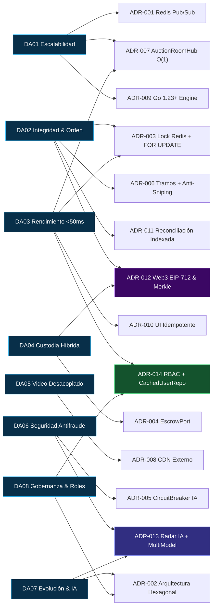

# Decisiones arquitectónicas (ADR) — LiveBid

> **Proyecto:** LiveBid — Plataforma de Subastas en Tiempo Real  
> **Capa:** Análisis y Arquitectura de Software · **Versión:** 3.0

---

## 1. ¿Qué es un ADR?

Un **ADR (*Architecture Decision Record*)** documenta las decisiones técnicas estructurales del sistema, vinculando cada elección con los *Drivers Arquitectónicos* (`DA01`–`DA08`), su justificación técnica y el impacto verificable en el código.

---

## 2. Registro Oficial de Decisiones Arquitectónicas

| ID | Decisión Arquitectónica | Driver Relacionado | Justificación Técnica | Implementación Real en elRepositorio |
|---|---|---|---|---|
| **ADR-001** | Difusión Orientada a Eventos con Redis Pub/Sub Multiplexado | DA01 — Escalabilidad; DA03 — Rendimiento | Desacoplar la emisión de eventos de puja de los sockets individuales evitando cuellos de botella entre nodos. | `RedisBidNotifier` (`internal/adapters/realtime/redis_bid_notifier.go`) + `AuctionRoomHub` (`room_hub.go`). |
| **ADR-002** | Arquitectura Hexagonal (Puertos y Adaptadores) en Go | DA08 — Mantenibilidad; DA04 — Pagos | Aislar el núcleo del negocio (`domain` y `services`) de PostgreSQL, Redis, HTTP/WS, Web3 y proveedores de IA. | Estructura estricta en `internal/core/domain`, `internal/core/services` e `internal/adapters/*`. |
| **ADR-003** | Concurrencia de Doble Capa: Lock Distribuido Redis (`SETNX`) + `SELECT ... FOR UPDATE` | DA02 — Integridad; DA03 — Rendimiento | Evitar condiciones de carrera (*race conditions*) y auto-pujas concurrentes (`postor_lider_id <> postor_id`) bajo ráfagas de ofertas simultáneas. | `RedisLockAdapter` (`redis_lock_adapter.go`) + `PostgresBidRepository.RegistrarPujaAtomica` (`postgres_bid_repository.go`). |
| **ADR-004** | Custodia Financiera Desacoplada vía `EscrowPort` | DA04 — Pago externo | Permitir validar y retener garantías sin acoplar el motor de subastas a una pasarela bancaria única. | `EscrowPort` en `domain/ports.go` implementado por `PostgresEscrowRepository`. |
| **ADR-005** | Evaluación de Riesgo IA con `CircuitBreaker` (< 150 ms) y Fallback Heurístico | DA06 — Seguridad; DA03 — Rendimiento | Consultar a Google Gemini AI sin arriesgar la disponibilidad de la subasta si la red externa presenta alta latencia o errores. | `CircuitBreaker` (`internal/adapters/ai/circuit_breaker.go`) + `GeminiRiskAdapter` (`gemini_risk_adapter.go`). |
| **ADR-006** | Reglas Dinámicas de Tramos de Incremento y *Anti-Sniping* (+30 s) | DA02 — Integridad; DA07 — Formatos | Impedir que bots ganen en el último milisegundo sin dar oportunidad de réplica a otros postores. | `Subasta.ValidarYRegistrarPuja` y `CalcularIncrementoMinimo` en `internal/core/domain/auction.go` e `increment_rule.go`. |
| **ADR-007** | Multiplexación WebSocket $O(1)$ con `AuctionRoomHub` | DA01 — Escalabilidad; DA03 — Rendimiento | Si 5,000 clientes miran la misma subasta, abrir 5,000 suscripciones a Redis agotaría descriptores. El Hub comparte 1 sola suscripción Redis por sala activa. | `AuctionRoomHub` en `internal/adapters/realtime/room_hub.go` y `websocket_handler.go`. |
| **ADR-008** | Separación del Canal de Video (CDN) y Canal de Precio (WebSocket) | DA05 — Video externo | Garantizar que el precio y el martillazo viajen en $< 25\text{ ms}$ independientemente del buffering de video. | Video por CDN externo; telemetría de pujas por `GET /ws?subasta_id=...`. |
| **ADR-009** | Backend Compilado en Go 1.23+ (Huella < 30 MB RAM) | DA01 — Escalabilidad; DA03 — Rendimiento | Reducir el consumo de memoria en más del 80% respecto a runtimes interpretados y aprovechar goroutines ligeras (~2 KB). | Módulo `github.com/fxrl01/livebid-backend` compilado en binario estático multi-stage Docker. |
| **ADR-010** | Interfaz Reactiva de Sala en Vivo con Idempotencia Nativa | DA03 — Rendimiento; DA02 — Integridad | Prevenir envíos duplicados por doble clic o reconexión mediante generación automática de `Idempotency-Key` y reconexión exponencial WS. | Cliente en `tecnologia/boilerplate-clean-arquitecture/public/app.js` servido e integrado con la API. |
| **ADR-011** | Reconciliación Indexada de Subastas Vencidas (`ListarVencidas`) | DA02 — Integridad; DA03 — Rendimiento | Evitar *Full Table Scans* en el worker periódico utilizando un barrido indexado `WHERE estado IN ('ACTIVA', 'EN_CONTEO') AND fin_programado <= $1`. | `PostgresAuctionRepository.ListarVencidas` + `AuctionService.CerrarVencidas` al arranque y cada 1 s. |
| **ADR-012** | Capa Web3 Trustless: Verificación EIP-712, Árbol de Merkle y Smart Contract Escrow | DA02 — Integridad; DA04 — Custodia | Dotar a la plataforma de auditabilidad matemática descentralizada: cada puja puede llevar firma tipada EIP-712, el historial genera una `MerkleRoot` verificable en $O(\log_2 N)$ y la liquidación emite un recibo on-chain. | `domain/web3.go`, `adapters/web3/eip712_verifier.go`, `adapters/web3/evm_escrow_adapter.go` y `services/web3_audit_service.go`. |
| **ADR-013** | Capa de IA Exponencial: `MultiModelRouter` (Hot-Swap), Radar Asíncrono y Agentes Autónomos | DA06 — Seguridad; DA07 — IA Exponencial | Permitir cambiar de modelo LLM en caliente sin reiniciar el binario, detectar *Wash Trading*/*Shill Bidding* en un worker asíncrono no bloqueante y habilitar pujas delegadas a Agentes IA con techo `max_cap`. | `adapters/ai/multi_model_router.go`, `anomaly_detector.go`, `domain/ai_agent.go` y `services/agent_delegation_service.go`. |
| **ADR-014** | Gobernanza RBAC con Caché Reactivo (`CachedUserRepository`) y Ficha de Encargado/Lote | DA03 — Rendimiento; DA08 — Gobernanza | Validar estado y rol (`POSTOR`, `VENDEDOR`, `MARTILLERO`, `ADMIN`) en $< 0.05\text{ ms}$ desde caché en memoria con invalidación instantánea al actualizar permisos, e incorporar la ficha legal del `EncargadoSubasta` y `DetallesLote`. | `CachedUserRepository` (`cached_user_repository.go`), `AuthHandler` y extensión de `Subasta`. |

---

## 3. Mapa de Trazabilidad: Drivers $\rightarrow$ ADRs

