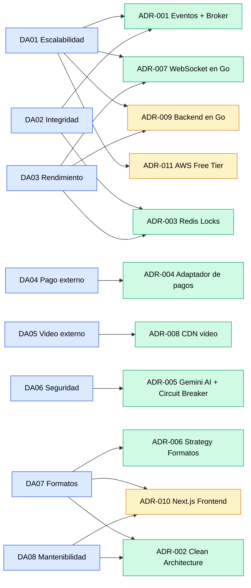

# Decisiones arquitectónicas (ADR) — LiveBid

## ¿Qué es un ADR?

Un **ADR (Architecture Decision Record)** documenta las decisiones importantes que se toman durante el diseño de la arquitectura del software, junto con su justificación y el resultado esperado.

## Registro de decisiones

| ID | Decisión arquitectónica | Driver relacionado | Justificación | Resultado |
|---|---|---|---|---|
| ADR-001 | Arquitectura orientada a eventos con message broker | DA01 — Escalabilidad; DA02 — Integridad | Organizar la comunicación entre servicios mediante colas de mensajes para soportar alta concurrencia y garantizar el orden de las pujas. | RabbitMQ como broker central con cola dedicada por subasta activa. |
| ADR-002 | Clean / Hexagonal Architecture en Go | DA08 — Mantenibilidad; DA07 — Formatos | Separar las reglas del negocio de los detalles tecnológicos mediante structs e interfaces puras de Go para facilitar el mantenimiento y las pruebas unitarias. | Backend estructurado en `internal/core/domain`, `internal/core/services` e `internal/adapters`. |
| ADR-003 | Estrategia de caché con Redis | DA03 — Rendimiento | Reducir la latencia en la consulta del precio actual del lote, evitando golpear PostgreSQL en cada puja. | Redis almacena el precio en caliente y locks atómicos (`SETNX`); PostgreSQL mantiene el registro transaccional completo. |
| ADR-004 | Integración de pagos mediante interfaces y adaptadores | DA04 — Pago externo | Desacoplar los casos de uso del proveedor de pagos para poder cambiar de Stripe a Niubiz (u otro) sin modificar la lógica de negocio. | Interfaz `PaymentEscrowPort` en el dominio; adaptadores concretos en infraestructura. |
| ADR-005 | Trust Service y Agente de IA con Circuit Breaker | DA06 — Seguridad | Analizar el riesgo de fraude de cada puja sin comprometer la disponibilidad en caso de lentitud o caída del servicio externo. | Adaptador de Gemini AI con Circuit Breaker en memoria que conmuta a reglas heurísticas locales si la latencia supera los 150 ms. |
| ADR-006 | Patrón Strategy para formatos de subasta | DA07 — Formatos | Soportar múltiples formatos (ascendente, descendente, sellada, benéfica) sin lógica condicional acoplada. | Interfaz `AuctionStrategy` con implementaciones por formato; el Auction Engine delega la validación de reglas al strategy correspondiente. |
| ADR-007 | WebSocket en Go para difusión en tiempo real | DA03 — Rendimiento; DA01 — Escalabilidad | La actualización del precio debe llegar a todos los espectadores en menos de 50 ms. HTTP polling no cumple este requisito. | `WebSocket Hub` en Go usando Goroutines y canales concurrentes para broadcasting instantáneo. |
| ADR-008 | Video delegado a CDN externo | DA05 — Video externo | La distribución de video en vivo no debe pasar por el backend propio para evitar cuellos de botella y aprovechar la infraestructura especializada de un CDN. | CDN (Cloudflare Stream / AWS IVS) entrega el video directamente al navegador; el backend solo gestiona el "canal de precio". |
| ADR-009 | Adopción de Go (Golang) para el Backend Central | DA01 — Escalabilidad; DA03 — Rendimiento | El runtime de Node.js consume ~150MB+ de RAM por proceso, lo que provocaría fallos por OOM en instancias gratuitas de 1GB de RAM (AWS Free Tier). Go compila a un binario estático que consume únicamente ~20MB de RAM con latencia sub-milisegundo. | Motor de subastas y gateway desarrollados en Go 1.23+ con alto rendimiento y mínima huella de memoria. |
| ADR-010 | Adopción de Next.js para la Interfaz de Usuario | DA07 — Formatos; DA08 — Mantenibilidad | Se requiere una interfaz exclusiva, cinematográfica y de alto valor percibido para compradores VIP, con soporte de SSR para indexar bienes en buscadores (SEO) y cliente reactivo WebSocket. | Frontend construido con Next.js 15 (App Router, React 19) consumiendo la API y WebSockets de Go. |
| ADR-011 | Despliegue en AWS Free Tier con Almacenamiento Desacoplado | DA01 — Escalabilidad; DA03 — Rendimiento | Permitir que la plataforma opere en producción sin incurrir en costos iniciales de nube, manteniendo separación estricta entre cómputo y persistencia. | Despliegue en AWS EC2 (t3.micro), AWS RDS PostgreSQL 16 (Free Tier) y Redis desacoplado. |

## Diagrama de relación: Drivers → ADRs

