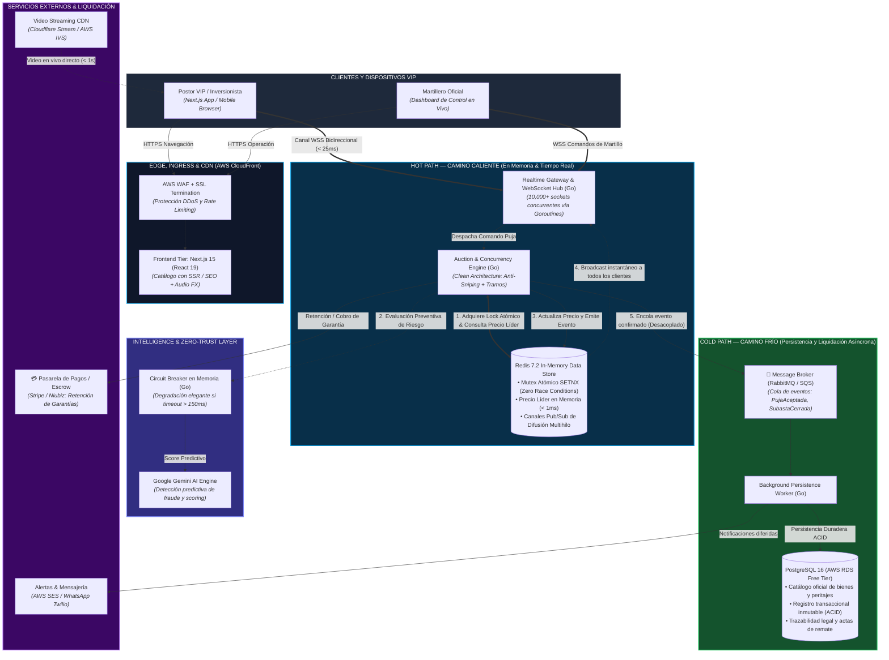

# 🚀 Arquitectura del Sistema LiveBid: High-Frequency Auction Engine

> **Proyecto:** LiveBid — Plataforma de Subastas en Tiempo Real de Alta Gama  
> **Tipo de Sistema:** Startup Cloud-Native, Event-Driven & AI-Assisted  
> **Estándar:** Software Design Description (SDD) · **Versión:** 2.0  
> **Infraestructura:** AWS Free Tier Ready (EC2 t3.micro + RDS + Redis)

---

## 1. De la Arquitectura Monolítica Tradicional al Diseño Startup Moderno

El diseño inicial típico de laboratorios universitarios (monolito de 3 capas lineales: *Presentación → Lógica → Base de datos única*) **no es viable para una startup de subastas en vivo**. En el mundo real, someter una sola base de datos relacional a miles de pujas simultáneas por segundo mediante llamadas HTTP bloqueantes genera saturación de conexiones (*connection pool exhaustion*), colisiones de concurrencia y latencias superiores a 1.5 segundos (haciendo imposible la experiencia del martillazo).

LiveBid adopta la arquitectura utilizada por plataformas líderes de trading y subastas en tiempo real (como Robinhood, Sotheby’s y OpenSea): **Desacoplamiento Hot Path / Cold Path con Clean Architecture en Go, WebSockets nativos y evaluación de riesgo con Inteligencia Artificial (Gemini).**

---

## 2. Diagrama de Arquitectura Global (Cloud-Native Startup Topology)

---

## 3. ¿Por qué este diseño es Innovador y Startup-Ready?

### A. La Separación Fundamental: *Hot Path* vs. *Cold Path*
Las startups de alto rendimiento no mezclan el procesamiento en vivo con el guardado en disco:
1. **Hot Path (Camino Crítico en Vivo — Latencia $< 25$ ms):**
   - Cuando un postor envía una oferta, el flujo viaja por **WebSockets nativos de Go** directamente a la memoria RAM.
   - Se valida la puja y se adquiere un **lock atómico distribuido en Redis (`SETNX`)** en $< 1.5$ ms.
   - El precio líder se actualiza en memoria y se difunde inmediatamente a toda la sala de postores.
   - **Resultado:** Los usuarios sienten la inmediatez absoluta del remate sin esperar a que el disco escriba.
2. **Cold Path (Camino Asíncrono de Persistencia y Auditoría):**
   - Una vez aprobada la puja en el *Hot Path*, se emite un evento al broker de mensajería.
   - Workers en segundo plano guardan el registro en **PostgreSQL 16**, calculan los hashes de auditoría legal y coordinan la facturación.
   - Si la base de datos relacional se ralentiza por una consulta pesada, **el remate en vivo jamás se detiene**.

---

### B. Inteligencia Artificial en el Flujo Crítico con *Circuit Breaker*
En lugar de depender pasivamente de reglas fijas, LiveBid integra a **Google Gemini AI** para evaluar anomalías de puja, suplantación o intentos de manipulación del precio:
- **Resiliencia Extrema (Circuit Breaker):** Si la API externa de IA tarda más de 150 ms o presenta microcortes, el Circuit Breaker conmuta de forma transparente a una heurística local en memoria de Go.
- La subasta **nunca se bloquea ni aborta** por fallos en servicios externos.

---

### C. Eficiencia Brutal de Recursos en AWS Free Tier (1 GB RAM)

| Componente | Enfoque Monolítico Tradicional | Enfoque LiveBid (Startup Moderna) | Impacto en AWS Free Tier |
|---|---|---|---|
| **Lenguaje Backend** | Node.js (~150 MB – 250 MB por proceso) | **Go compilado (~20 MB de RAM)** | 🟢 Ahorro de más del 80% de memoria en instancias `t2.micro` / `t3.micro`. |
| **Concurrencia** | Event Loop monohilo (riesgo de bloqueo) | **Goroutines nativas** (~2 KB de stack por socket) | 🟢 Soporta más de 10,000 conexiones concurrentes con mínima CPU. |
| **Estructura Interna** | Código acoplado a Express / TypeORM | **Clean Architecture (Hexagonal)** | 🟢 Dominio 100% puro, desacoplado y con pruebas unitarias en 0.002s. |
| **Frontend** | SPA básica sin SEO | **Next.js 15 (React 19) con SSR** | 🟢 Catálogo indexable en Google y experiencia cinematográfica exclusiva. |
| **Costos Operativos** | Exige múltiples servidores dedicados | **Arquitectura optimizada para Costo $0 inicial** | 🟢 Permite validar el producto en el mercado sin quemar capital inicial. |

---

## 4. Matriz de Componentes y Responsabilidades

| Contenedor / Módulo | Tecnología | Capa SDD | Responsabilidad Clave |
|---|---|---|---|
| **Frontend de Lujo** | Next.js 15, React 19, Tailwind CSS | Presentación | Sala de remate interactiva, gráficos en tiempo real, efectos sonoros del martillo y SSR para SEO. |
| **API Gateway & WS Hub** | Go (Golang 1.23+), Gorilla WebSockets | Presentación | Control de tráfico, autenticación JWT en handshake, heartbeat y broadcast concurrente. |
| **Auction Core Engine** | Go 1.23+, Clean Architecture | Dominio & Aplicación | Orquestador de la subasta: validación de tramos, extensión anti-sniping (+30s) y adjudicación. |
| **Caché & Mutex Atómico** | Redis 7.2 In-Memory | Infraestructura | Control de concurrencia atómica (anti-colisiones) y distribución de eventos Pub/Sub. |
| **Base de Datos Transaccional** | PostgreSQL 16 (AWS RDS Free Tier) | Infraestructura | Almacén de verdad contable y legal: usuarios, catálogo, depósitos en garantía y auditoría inmutable. |
| **Agente de Riesgo IA** | Gemini API + Circuit Breaker en Go | Infraestructura | Evaluación de patrones de fraude y validación de solvencia crediticia. |
s