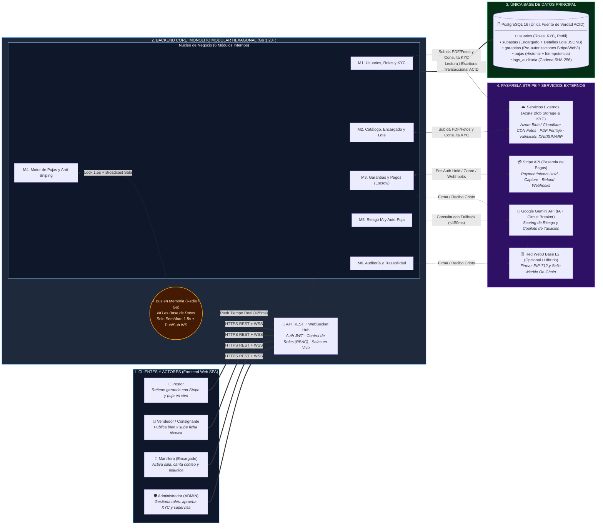

# 🏛️ Arquitectura de Software LiveBid: Monolito Modular Hexagonal para Desarrollo Continuo

> **Proyecto:** LiveBid — Plataforma de Subastas en Tiempo Real  
> **Enfoque Arquitectónico:** Monolito Modular con Arquitectura Hexagonal (Puertos y Adaptadores)  
> **Principio Rector:** **Simplicidad Operativa + Evolución Continua** (1 solo binario Backend en Go, **1 sola Base de Datos Principal en PostgreSQL**, y Adaptadores Externos desacoplados para **Stripe**, **Servicios Externos KYC/Storage**, **IA Gemini** y **Web3**).  
> **Visor Interactivo:** [`livebid-arquitectura.html`](file:///home/fernando/Softwar_Architect/PlataformaSubastas-arquitSoft-02-Fernando/docs/02-arquitectura-software/livebid-arquitectura.html)

---

## 1. Visión del Arquitecto: ¿Cómo evitar la sobre-ingeniería y lograr un Desarrollo Continuo?

Para que el proyecto avance rápido, sea fácil de mantener por el equipo y escale sin fricción, aplicamos **tres decisiones de arquitectura pragmática**:

### Decisión 1: Monolito Modular Hexagonal (No Microservicios Complejos)
En lugar de dividir el sistema en múltiples microservicios difíciles de desplegar, todo el backend corre en **un único servicio en Go 1.23+ (`livebid-backend`)** organizado internamente en **6 módulos de negocio limpios**. Si mañana queremos cambiar Stripe por otra pasarela o actualizar Gemini, solo tocamos su adaptador externo sin romper las reglas de subasta.

### Decisión 2: Una Sola Base de Datos (`PostgreSQL 16`) vs. Bus Efímero en Memoria (`Redis`)
Un error común en los diagramas es mostrar a **Redis** y **PostgreSQL** juntos como si el sistema tuviera dos bases de datos. En **LiveBid** la separación es tajante:

| Tecnología | Rol Real en la Arquitectura | ¿Guarda datos permanentes? | ¿Qué pasa si se reinicia? |
| :--- | :--- | :---: | :--- |
| **PostgreSQL 16** | **ÚNICA BASE DE DATOS DEL SISTEMA (Single Source of Truth)** | **SÍ (100% ACID)** | Conserva todos los usuarios, roles, subastas, encargado, lote, garantías Stripe, pujas y auditoría. |
| **Redis 7** | **Bus Efímero en Memoria (Semáforo de 1.5s + Megáfono WebSocket)** | **NO (0% Persistencia)** | **No se pierde ningún dato de negocio.** Solo coordina la fila india de pujas en vivo y el caché temporal. Incluso en desarrollo local Go puede operar con canales en memoria. |

### Decisión 3: Pasarela de Pagos Stripe y Servicios Externos como Adaptadores (`Plug & Play`)
El núcleo de subastas se conecta hacia afuera mediante interfaces limpias (`Ports`) hacia los servicios externos reales del negocio:
1. **Pasarela de Pagos Stripe (`Stripe Escrow Adapter`):** Maneja la retención preventiva en tarjeta (`PaymentIntent` con `capture_method: manual`), el cobro definitivo al ganador (`capture`) y la liberación inmediata a los postores no ganadores (`cancel`), además de recibir confirmaciones por **Stripe Webhooks**.
2. **Servicios Externos de Almacenamiento y KYC (`Azure Blob Storage / Cloudflare CDN + Verificación`):** Alojamiento de fotografías del lote, certificados PDF de tasación pericial y validación de identidad/colegiatura del Martillero.
3. **Google Gemini API (`AI Risk & Appraisal Adapter`):** Evalúa el riesgo crediticio del postor con un *Circuit Breaker* de seguridad (si la API externa tarda más de `150 ms`, el sistema aplica una regla local automática sin detener la subasta).
4. **Pasarela Web3 Opcional (`Base L2 / EIP-712`):** Permite a postores cripto firmar pujas con billetera y anclar el certificado de auditoría (`Merkle Root`) sin afectar el flujo tradicional en dólares/moneda local.

---

## 2. Diagrama de Arquitectura Simplificado y Escalable (4 Capas Claras)



---

## 3. Módulos del Sistema a Desarrollar (Hoja de Ruta de Desarrollo Continuo)

Para evitar complejidades y desarrollar de forma continua, el sistema se construye sobre **6 módulos bien delimitados**. Cada módulo tiene su propia responsabilidad, sus propios endpoints y trabaja sobre la misma base de datos PostgreSQL:

### Módulo 1: Gestión de Usuarios, Roles (`RBAC`) y Panel de Administración
- **Objetivo:** Controlar quién entra al sistema, qué rol solicita al registrarse y permitir que el Administrador apruebe cuentas (`KYC`) y asigne permisos.
- **Roles Soportados:** `ADMIN` (Administrador del sistema), `MARTILLERO` (Encargado oficial del remate), `VENDEDOR` (Propietario/Consignante del bien) y `POSTOR` (Comprador).
- **Tabla en PostgreSQL:** `usuarios` y `refresh_tokens`.
- **Servicio Externo:** Validación documental KYC / Identidad.
- **Estado:** ✅ **Backend Implementado** (`/api/v1/auth/*` y `/api/v1/admin/users/*`).

### Módulo 2: Catálogo de Subastas, Ficha del Encargado y Detalles Periciales del Lote
- **Objetivo:** Permitir registrar el lote a subastar junto con toda su respaldo técnico/legal y los datos oficiales del encargado de dirigir la subasta.
- **Datos Clave que Gestiona:**
  - **Ficha del Encargado (`EncargadoSubasta`):** Nombre del martillero, número de licencia/registro oficial, cargo, experiencia y datos de contacto.
  - **Detalles Técnicos del Lote (`DetallesLote`):** Categoría, ubicación física, precio de reserva, perito inspector, enlace al certificado de tasación (PDF), galería de imágenes y tabla de especificaciones técnicas.
- **Tabla en PostgreSQL:** `subastas` (con columnas nativas `JSONB` para `encargado_json` y `detalles_lote_json`).
- **Servicio Externo:** Azure Blob Storage / Cloudflare CDN para alojar imágenes del bien y el PDF del peritaje.
- **Estado:** ✅ **Backend Implementado** (`PUT /api/v1/subastas/{id}/encargado` y `PUT /api/v1/subastas/{id}/detalles-lote`).

### Módulo 3: Pasarela de Pagos con Stripe y Custodia de Garantías (`Escrow`)
- **Objetivo:** Garantizar que ningún postor puje sin respaldo económico real, congelando una garantía antes de entrar a la sala y liberándola automáticamente si no resulta ganador.
- **Flujo con Stripe (`PaymentIntents API`):**
  1. **Retención (`Pre-Auth Hold`):** Se crea un `PaymentIntent` en Stripe con `capture_method: "manual"` por el porcentaje de garantía (ej. 10% del precio base). El dinero queda retenido en la tarjeta del postor sin cobrarse aún.
  2. **Liquidación al Cierre:** Cuando el martillero cierra la subasta, el backend ejecuta `Capture` sobre el ganador y `Cancel` (liberación inmediata sin comisión de reembolso) para todos los demás postores.
  3. **Sincronización por Webhook:** Endpoint `/api/v1/webhooks/stripe` verifica la firma de Stripe (`Stripe-Signature`) y actualiza el estado de la garantía (`RETENIDA`, `CAPTURADA_COBRO`, `LIBERADA`).
- **Tabla en PostgreSQL:** `garantias`.
- **Servicio Externo:** **Stripe API** (Pagos Fiat en USD/PEN) + **Smart Contract Base L2** (opcional para garantías en `USDC`).
- **Estado:** 🔄 **Base de Garantías Lista / Integración de Adaptador Stripe y UI en Desarrollo Continuo**.

### Módulo 4: Sala en Vivo, Motor de Pujas y Control de Martillo (`Realtime Engine`)
- **Objetivo:** Procesar las ofertas en tiempo real sin colisiones y transmitir cada cambio de precio y conteo de martillo a todos los participantes en menos de `25 ms`.
- **Reglas de Negocio:**
  - Escala dinámica de incrementos mínimos.
  - **Regla Anti-Sniping:** Si entra una puja en los últimos `15 segundos`, el reloj se extiende automáticamente `+30 segundos`.
  - **Estados del Martillo:** `PENDIENTE` $\rightarrow$ `ACTIVA` $\rightarrow$ `EN_CONTEO` (*a la una, a las dos...*) $\rightarrow$ `CERRADA`.
- **Coordinación en Memoria:** Usa el semáforo de Redis (`SETNX`) durante `1.5s` mientras guarda en PostgreSQL y emite el evento por WebSocket (`AuctionRoomHub`).
- **Tabla en PostgreSQL:** `pujas` y `subastas`.
- **Estado:** ✅ **Backend Implementado** (`POST /api/v1/subastas/{id}/pujas`, `POST /api/v1/subastas/{id}/conteo` y `WS /ws`).

### Módulo 5: Copiloto de IA (Google Gemini) y Prevención de Fraude
- **Objetivo:** Asistir en la evaluación de riesgo del postor (ajustando la garantía del 10% al 20% si hay alto riesgo) y ofrecer auto-puja inteligente con límite de presupuesto (`max_cap`).
- **Resiliencia sin Complejidad:** Incluye un **Circuit Breaker** local: si Google Gemini no responde en `150 ms` o no hay API Key configurada, el sistema calcula el puntaje con una fórmula determinista en Go sin detener el desarrollo ni las pruebas.
- **Servicio Externo:** **Google Gemini API** (`gemini-2.5-flash` / `gemini-2.5-pro`).
- **Estado:** ✅ **Backend Implementado** (`/api/v1/agentes/delegar` y `/api/v1/admin/ia/*`).

### Módulo 6: Auditoría Forense y Acta de Adjudicación Verificable
- **Objetivo:** Dar validez legal y transparencia total al proceso de subasta frente a vendedores, compradores y auditores.
- **Funcionamiento:** Cada puja genera un eslabón criptográfico `SHA-256` encadenado al anterior en la tabla `logs_auditoria` de PostgreSQL, y al cierre de la subasta genera la raíz de verificación (`Merkle Root`) para comprobar que ninguna oferta fue alterada ni borrada.
- **Tabla en PostgreSQL:** `logs_auditoria`.
- **Estado:** ✅ **Backend Implementado** (`GET /api/v1/subastas/{id}/auditoria-web3`).

---

## 4. Resumen de Flujo de Trabajo para Desarrollo Continuo

```
┌──────────────────────────────────────────────────────────────────────────────┐
│  FLUJO DE DESARROLLO CONTINUO (SIN COMPLEJIDAD DE INFRAESTRUCTURA)           │
├──────────────────────────────────────────────────────────────────────────────┤
│  Paso 1: Definir/ajustar entidad en internal/core/domain                     │
│  Paso 2: Agregar método en el caso de uso (internal/core/services)           │
│  Paso 3: Guardar en la ÚNICA Base de Datos (PostgreSQL 16)                   │
│  Paso 4: Si requiere pago/IA/archivos -> Conectar Adaptador (Stripe/Azure/IA) │
│  Paso 5: Exponer endpoint REST/WS y conectar en el Frontend SPA              │
└──────────────────────────────────────────────────────────────────────────────┘
```
