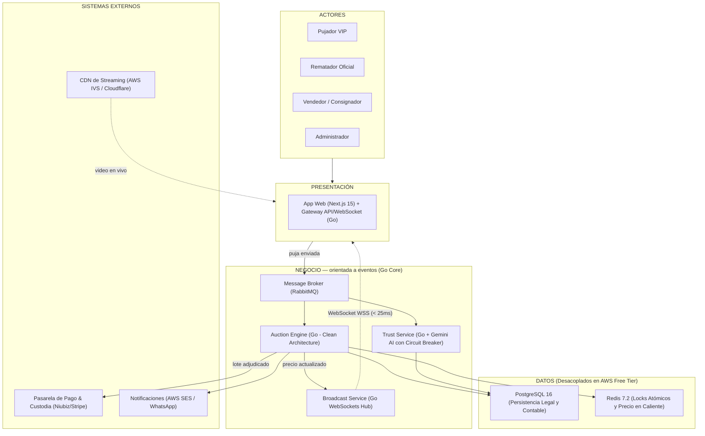

# Arquitectura inicial del sistema — LiveBid

## De 3 capas a "capas + orientada a eventos"

El ejemplo de la guía organiza el sistema en tres capas puras: Presentación → Lógica de negocio → Datos, con llamadas síncronas de arriba hacia abajo. Los drivers arquitectónicos **DA01** (1,000+ usuarios concurrentes), **DA02** (orden verificable de pujas) y **DA06** (filtro de fraude en el camino crítico) hacen que ese modelo puro no alcance para representar el sistema con honestidad: la capa de negocio no es un solo bloque que responde llamadas una por una, sino un conjunto de servicios independientes que se comunican de forma asíncrona a través de un **message broker**.

Por eso mantenemos las mismas tres preguntas que la guía usa para justificar cada capa, pero la capa de negocio se subdivide en servicios conectados por eventos en lugar de una sola responsabilidad monolítica.

| Capa | Pregunta que responde | Tecnología Oficial |
|---|---|---|
| Presentación | ¿Cómo interactúa el usuario? | **Next.js 15 (React 19)** con interfaz cinematográfica de lujo + Gateway WebSocket en **Go** |
| Negocio (orientada a eventos) | ¿Qué hace el sistema, y en qué orden lo garantiza? | **Auction Engine en Go** + Message Broker (RabbitMQ) + Trust Agent (Gemini AI con Circuit Breaker) |
| Datos | ¿Dónde se almacena la información? | **PostgreSQL 16** (ACID relacional) + **Redis 7.2** (precio en caliente y locks `SETNX`) |
| Sistemas externos | ¿Con qué depende el sistema que no controla directamente? | Pasarela de pagos (Stripe / Niubiz) + CDN de streaming de video (AWS IVS / Cloudflare) |

## Diagrama de arquitectura

## Responsabilidades por capa

- **Presentación**: La app web en **Next.js 15** muestra el catálogo de subastas con SSR (SEO), reproduce audio dinámico de martillazo, embebe el video del CDN y envía cada puja por WebSocket al gateway en Go.
- **Negocio (orientada a eventos)**:
  - *Message Broker (RabbitMQ)*: encola cada puja y garantiza su orden dentro de la subasta correspondiente.
  - *Auction Engine (Go)*: consume la cola, valida la puja contra el precio actual y el incremento mínimo en memoria ($< 3$ ms), aplica la regla anti-sniping y decide si se acepta.
  - *Trust Service (Go + Gemini AI)*: consume el mismo evento en paralelo y calcula el puntaje de confianza del pujador con Circuit Breaker preventivo.
  - *Broadcast Service (Go)*: toma el resultado del Auction Engine y lo empuja por WebSocket a todos los postores conectados en $< 25$ ms.
- **Datos**: PostgreSQL guarda el registro transaccional definitivo (usuarios, subastas, pujas, pagos); Redis mantiene el precio actual y los locks atómicos en memoria para lecturas rápidas sin golpear la base de datos relacional.
- **Sistemas externos**: la pasarela de pago se activa para retener garantías y liquidar el lote ganador; el CDN entrega el video directamente a la app del espectador, sin pasar por el backend propio.

## Viabilidad en AWS Free Tier

Al migrar el núcleo del backend a **Go (Golang)**, el consumo de RAM de los servicios pasa de ~400 MB (típico en Node.js) a menos de **50 MB**. Esto permite ejecutar la aplicación completa en una instancia `t2.micro` o `t3.micro` (1 vCPU, 1 GB RAM) junto a PostgreSQL (AWS RDS Free Tier) y Redis sin riesgo de saturación de memoria.
