# Componentes Arquitectónicos — LiveBid

> **Proyecto:** LiveBid — Plataforma de Subastas en Tiempo Real  
> **Capa:** Arquitectura de Software · Componentes de Sistema  
> **Enfoque:** Clean Architecture + Event-Driven Architecture  
> **Versión:** 1.0

---

## 1. Visión General de Componentes

La arquitectura de **LiveBid** se compone de módulos desacoplados bajo el enfoque de **Clean Architecture**, asegurando que el motor de subasta y la lógica del martillazo no dependan de frameworks web, bases de datos específicas o servicios externos de pago.

```mermaid
graph TD
    subgraph Presentacion["1. Capa de Presentación (Interface Adapters)"]
        WSHandler["WebSocket Room Handler<br><i>(Socket.io / WS Server)</i>"]
        RESTCtrl["REST Controllers<br><i>(Subastas, Usuarios, Pagos)</i>"]
        EventSub["Event Consumers / Listeners<br><i>(RabbitMQ Subscribers)</i>"]
    end

    subgraph Aplicacion["2. Capa de Aplicación (Use Cases)"]
        UCPuja["ProcesarPujaEnTiempoReal<br><i>(Caso de uso crítico)</i>"]
        UCSubasta["GestionarCicloSubasta<br><i>(Iniciar, Martillazo, Adjudicar)</i>"]
        UCEscrow["RetenerGarantiaEscrow<br><i>(Bloqueo de fondos)</i>"]
        UCAudit["RegistrarTrazabilidadAuditoria<br><i>(Log inmutable)</i>"]
    end

    subgraph Dominio["3. Capa de Dominio (Core Enterprise Rules)"]
        EntSubasta["Entidad Subasta<br><i>(State Machine del lote)</i>"]
        EntPuja["Entidad / Value Object Puja<br><i>(Monto, Timestamp, Secuencia)</i>"]
        PortRepo["Puerto Repositorio Subastas<br><i>(ISubastaRepository)</i>"]
        PortEngine["Puerto Motor Concurrencia<br><i>(IBidEngineLock)</i>"]
        PortPayment["Puerto Pasarela Escrow<br><i>(IPaymentEscrowPort)</i>"]
        PortNotifier["Puerto Difusión Eventos<br><i>(IRoomNotifierPort)</i>"]
    end

    subgraph Infraestructura["4. Capa de Infraestructura (Frameworks & Drivers)"]
        AdapRedis["Adaptador Redis<br><i>(Atomic Locks & PubSub)</i>"]
        AdapPostgres["Adaptador PostgreSQL<br><i>(Persistencia transaccional)</i>"]
        AdapRabbit["Adaptador RabbitMQ<br><i>(Cola de eventos de subasta)</i>"]
        AdapNiubiz["Adaptador Pasarela Pagos<br><i>(Niubiz / Stripe API)</i>"]
    end

    WSHandler --> UCPuja
    RESTCtrl --> UCSubasta
    RESTCtrl --> UCEscrow
    EventSub --> UCAudit

    UCPuja --> EntSubasta
    UCPuja --> EntPuja
    UCPuja --> PortRepo
    UCPuja --> PortEngine
    UCPuja --> PortNotifier

    UCSubasta --> EntSubasta
    UCSubasta --> PortRepo

    UCEscrow --> PortPayment

    AdapRedis -.->|Implementa| PortEngine
    AdapRedis -.->|Implementa| PortNotifier
    AdapPostgres -.->|Implementa| PortRepo
    AdapRabbit -.->|Implementa| PortNotifier
    AdapNiubiz -.->|Implementa| PortPayment
```

---

## 2. Detalle de Capas y Componentes

### 2.1 Capa de Presentación
- **WebSocket Room Handler:** Gestiona el ciclo de vida de los sockets de clientes conectados a la sala de remate, valida sesiones JWT de conexión y encamina eventos entrantes (`puja:emitir`, `sala:unirse`).
- **Controladores REST:** Endpoints HTTP `/api/v1` para la autenticación de usuarios, registro de catálogo de bienes, consulta histórica y depósito de garantías.
- **Event Consumers:** Receptores de mensajes asíncronos desacoplados provenientes de colas de RabbitMQ para procesamiento en segundo plano (facturación, notificaciones por email/SMS).

### 2.2 Capa de Aplicación
- **ProcesarPujaEnTiempoReal (Caso de uso crítico):** 
  1. Verifica que la subasta esté en estado `ACTIVA` o `EN_CONTEO`.
  2. Valida mediante `IPaymentEscrowPort` que el postor tenga garantía suficiente.
  3. Adquiere lock distribuido en Redis (`IBidEngineLock`) para asegurar atomicidad.
  4. Incrementa el precio y registra la nueva puja líder con timestamp oficial del servidor.
  5. Difunde el nuevo estado a la sala mediante `IRoomNotifierPort`.
- **GestionarCicloSubasta:** Orquesta las transiciones de estado del lote (Programada $\rightarrow$ En Vivo $\rightarrow$ Cuenta Regresiva $\rightarrow$ Martillo 1 $\rightarrow$ Martillo 2 $\rightarrow$ Martillazo Final $\rightarrow$ Adjudicada).
- **RetenerGarantiaEscrow:** Congela el porcentaje de garantía del postor antes de permitirle ingresar a la sala de pujas activas.

### 2.3 Capa de Dominio
- **Entidad Subasta:** Raíz de agregado (Aggregate Root) que contiene las reglas invariantes de negocio: incremento mínimo por tramo de precio, extensión automática de tiempo si hay puja en los últimos 15 segundos ("Anti-Sniping"), y validación de postor líder.
- **Entidad Puja:** Representa la oferta realizada con su valor numérico, identificador del postor, marca temporal inmutable y correlativo de sala.
- **Puertos de Salida (Interfaces):**
  - `ISubastaRepository`: Abstracción para persistir y consultar subastas.
  - `IBidEngineLock`: Abstracción para control de concurrencia y mutéx atómico.
  - `IPaymentEscrowPort`: Abstracción para retención y liberación de garantías financieras.
  - `IRoomNotifierPort`: Abstracción para publicación en tiempo real a clientes.

### 2.4 Capa de Infraestructura
- **Redis Adapter:** Utiliza comandos atómicos (`SETNX`, scripts Lua) para control de concurrencia en $< 2$ ms y Redis Pub/Sub para propagar eventos a todas las instancias del Gateway.
- **PostgreSQL Adapter:** Persiste datos con integridad referencial ACID (usuarios, bienes subastados, transacciones financieras consolidadas y log de auditoría).
- **RabbitMQ Adapter:** Cola de mensajería duradera que garantiza la entrega de eventos de negocio a los sistemas de facturación y notificaciones externas.
- **Payment Adapter:** Cliente HTTP hacia pasarelas autorizadas (ej. Niubiz / Stripe) para autorización y captura de fondos.

---

## 3. Matriz de Trazabilidad: Requisitos $\rightarrow$ Componentes

| Requisito Funcional | Atributo de Calidad / Escenario | Componente Responsable | Patrón Aplicado |
|---|---|---|---|
| **RF-01: Autenticación y Verificación** | EQ-04 (Seguridad Zero Trust) | `RESTCtrl Usuarios`, Middleware JWT | Chain of Responsibility |
| **RF-02: Depósito de Garantía (Escrow)** | EQ-04 (Fondos en Custodia) | `UCEscrow`, `IPaymentEscrowPort`, `AdapNiubiz` | Adapter, Facade |
| **RF-03: Sala de Subasta en Vivo** | EQ-03 (Disponibilidad y Resiliencia) | `WSHandler`, `IRoomNotifierPort`, `AdapRedis` | Observer, Pub-Sub |
| **RF-04: Procesamiento de Puja** | EQ-01 (Rendimiento <200ms) | `UCPuja`, `IBidEngineLock`, `AdapRedis` | Mutex Atómico, Command |
| **RF-05: Prevención de Colisiones** | EQ-02 (Anti-Race Condition) | `EntSubasta`, Secuenciador Redis + RabbitMQ | State Machine, FIFO Queue |
| **RF-06: Adjudicación y Liquidación** | EQ-05 (Mantenibilidad) | `UCSubasta`, `ISubastaRepository`, `AdapPostgres` | Repository, Unit of Work |

