# Componentes Arquitectónicos — LiveBid

> **Proyecto:** LiveBid — Plataforma de Subastas en Tiempo Real  
> **Capa:** Arquitectura de Software · Componentes de Sistema  
> **Enfoque:** Monolito Modular Hexagonal (Clean Architecture) con **1 Sola Base de Datos (`PostgreSQL 16`)**, Coordinación en Memoria (`Redis`) y Adaptadores Externos (`Stripe`, `Cloud Storage/KYC`, `Gemini IA`, `Web3`)  
> **Versión:** 3.1

---

## 1. Visión General de Componentes (Sin Sobre-Ingeniería)

La arquitectura de **LiveBid** se organiza en un único backend en **Go 1.23+** siguiendo la **Arquitectura Hexagonal (Puertos y Adaptadores)**. El núcleo de negocio está completamente limpio y se conecta hacia afuera con:
1. **PostgreSQL 16** como **Única Base de Datos del Sistema (Single Source of Truth)**.
2. **Redis 7** únicamente como **Coordinador Efímero en Memoria** (semáforo `SETNX` de `1.5s` y difusión de eventos WebSocket, **no** como segunda base de datos).
3. **Adaptadores de Servicios Externos:** **Pasarela de Pagos Stripe**, **Almacenamiento Cloud / Validación KYC**, **Google Gemini IA** y **Pasarela Web3 Opcional**.

```mermaid
graph TD
    subgraph Presentacion["1. Adaptadores Primarios (Entrada HTTP / WebSocket / Webhooks)"]
        AuthHandler["Auth & Admin RBAC Handler<br><i>(Registro, Login, Roles, Aprobación KYC)</i>"]
        AuctionHandler["Auction & Catalog Handler<br><i>(Subastas, Ficha Encargado, Detalles Lote)</i>"]
        BidHandler["Bid & Stripe Escrow Handler<br><i>(Pujas, Retención Stripe Hold, Webhooks)</i>"]
        AIHandler["Agent & AI Handler<br><i>(Auto-Puja y Copiloto IA)</i>"]
        WSHandler["WebSocket Handler + AuctionRoomHub<br><i>(Salas en Vivo en Tiempo Real)</i>"]
    end

    subgraph Aplicacion["2. Capa de Aplicación — Los 6 Módulos de Negocio (internal/core/services)"]
        AuthSvc["M1. AuthService<br><i>(Identidad, JWT, Roles y Estado KYC)</i>"]
        CatalogSvc["M2. AuctionCatalogService<br><i>(Crear, EncargadoSubasta, DetallesLote, Conteo)</i>"]
        EscrowSvc["M3. GuaranteeService (Stripe & Escrow)<br><i>(Retener Garantía, Capturar Ganador, Liberar Resto)</i>"]
        AuctionSvc["M4. AuctionService & BidService<br><i>(ProcesarPuja Atómica, Anti-Sniping y CerrarVencidas)</i>"]
        AgentSvc["M5. AgentDelegationService & Risk<br><i>(Scoring IA con Fallback y Auto-Puja)</i>"]
        Web3Svc["M6. Web3AuditService<br><i>(Cadena SHA-256 y Acta Merkle)</i>"]
    end

    subgraph Dominio["3. Capa de Dominio Puro (internal/core/domain)"]
        EntSubasta["Aggregate Root: Subasta<br><i>(EncargadoSubasta, DetallesLote, Anti-Sniping, Tramos)</i>"]
        EntUser["Entidad: User & RBAC<br><i>(POSTOR, VENDEDOR, MARTILLERO, ADMIN)</i>"]
        EntGuarantee["Entidad: Guarantee (Escrow)<br><i>(RETENIDA, CAPTURADA_COBRO, LIBERADA)</i>"]
        Ports["Puertos de Salida (Interfaces Go)<br><i>(Repositories, PaymentEscrowPort, AIRiskPort, BidLockPort)</i>"]
    end

    subgraph BaseDeDatos["4A. Única Base de Datos Principal (Persistencia ACID)"]
        AdapPostgres[("🗄️ PostgreSQL 16 (Única BD)<br><i>usuarios · subastas (JSONB) · garantias · pujas · logs_auditoria</i>")]
    end

    subgraph CoordinacionMemoria["4B. Coordinación Efímera en Memoria (NO es Base de Datos)"]
        AdapRedis(("⚡ Bus en Memoria (Redis / Go)<br><i>Semáforo 1.5s (SETNX) + Pub/Sub Salas WS + Caché Volátil</i>"))
    end

    subgraph ServiciosExternos["4C. Pasarela Stripe y Servicios Externos (Adaptadores Plug & Play)"]
        AdapStripe["💳 Stripe Payment Adapter<br><i>(PaymentIntents Hold, Capture, Cancel & Webhooks)</i>"]
        AdapDocs["☁️ Cloud Storage & KYC Adapter<br><i>(Fotos del Lote, PDF Peritaje S3/CDN, Validación DNI/SUNARP)</i>"]
        AdapAI["🤖 Gemini AI Adapter + CircuitBreaker<br><i>(Evaluación de Riesgo <150ms con Fallback Local)</i>"]
        AdapWeb3["⛓️ Web3 Adapter (Opcional)<br><i>(Firma EIP-712 y Sello Merkle en Base L2)</i>"]
    end

    AuthHandler --> AuthSvc
    AuctionHandler --> CatalogSvc & Web3Svc
    BidHandler --> AuctionSvc & EscrowSvc
    AIHandler --> AgentSvc
    WSHandler --> AuctionSvc

    AuthSvc & CatalogSvc & EscrowSvc & AuctionSvc & AgentSvc & Web3Svc --> EntSubasta & EntUser & EntGuarantee
    AuthSvc & CatalogSvc & EscrowSvc & AuctionSvc & AgentSvc & Web3Svc --> Ports

    AdapPostgres -.->|Persistencia Única| Ports
    AdapRedis -.->|Lock y Broadcast| Ports
    AdapStripe -.->|Pagos Fiat| Ports
    AdapDocs -.->|Archivos y KYC| Ports
    AdapAI -.->|IA Resiliente| Ports
    AdapWeb3 -.->|Auditoría Cripto| Ports
```

---

## 2. Claridad Arquitectónica: ¿Qué hace cada pieza de infraestructura?

### 2.1 PostgreSQL 16 (La Única Base de Datos del Proyecto)
- Es la **única fuente de verdad** donde se guardan datos permanentes.
- Combina tablas relacionales clásicas (`usuarios`, `garantias`, `pujas`, `logs_auditoria`) con columnas flexibles `JSONB` en `subastas` (`encargado_json` y `detalles_lote_json`) para almacenar certificados periciales, galería de fotos y especificaciones sin necesidad de crear decenas de tablas secundarias ni agregar una base de datos NoSQL adicional.

### 2.2 Redis 7 (Coordinador Efímero en Memoria — No Base de Datos)
- **No almacena ninguna tabla ni registro de negocio.**
- Cumple exclusivamente dos funciones en tiempo real:
  1. **Semáforo Atómico (`SETNX` con expiración de 1.5 segundos):** Evita que dos postores ganen con el mismo monto en el mismo milisegundo.
  2. **Megáfono de Salas (`Pub/Sub`):** Difunde instantáneamente la nueva oferta a los clientes WebSocket conectados.
- **Ventaja para el desarrollo continuo:** Si un desarrollador levanta el backend en su máquina sin Redis, el servidor Go usa automáticamente su implementación en memoria nativa (`InMemoryLock` + `AuctionRoomHub`).

### 2.3 Pasarela de Pagos Stripe (`Stripe Escrow Adapter`)
- Conecta el módulo de garantías (`GuaranteeService`) con **Stripe API**:
  - **Pre-autorización (`Hold`):** Retiene el depósito de garantía en la tarjeta del postor (`capture_method: manual`) y guarda el `payment_intent_id` en `garantias.autorizacion_bancaria_id`.
  - **Liquidación Automática:** Al cerrarse la subasta, captura el depósito del postor ganador y libera sin costo las retenciones de los demás postores.

### 2.4 Servicios Externos de Almacenamiento y Verificación (`Cloud Storage & KYC`)
- Permite adjuntar en `DetallesLote` las URLs de fotografías de alta resolución y el **Certificado de Peritaje en PDF** alojados en S3/Cloudinary, así como verificar la identidad (`documento_identidad`) del postor y la licencia oficial del `Martillero`.

---

## 3. Matriz de Trazabilidad: Módulos $\rightarrow$ Componentes

| Módulo de Desarrollo Continuo | Servicios y Handlers en Go | Tabla en PostgreSQL 16 | Servicio Externo Asociado |
| :--- | :--- | :--- | :--- |
| **M1. Usuarios, Roles y Admin** | `AuthHandler`, `AuthService`, `CachedUserRepository` | `usuarios`, `refresh_tokens` | Verificación KYC / Correo |
| **M2. Catálogo, Encargado y Lote** | `AuctionHandler`, `AuctionCatalogService` | `subastas` (`encargado_json`, `detalles_lote_json`) | Cloud Storage (S3 / CDN Fotos y PDF) |
| **M3. Pagos Stripe y Garantías** | `EscrowHandler`, `GuaranteeService` | `garantias` | **Stripe API (PaymentIntents + Webhooks)** |
| **M4. Pujas en Vivo y Martillero** | `BidHandler`, `BidService`, `AuctionRoomHub` | `pujas`, `subastas` | Bus en Memoria (Redis Lock + Pub/Sub) |
| **M5. Copiloto IA y Auto-Puja** | `AgentAIHandler`, `AgentDelegationService`, `CircuitBreaker` | `subastas`, `garantias` | **Google Gemini API** (con Fallback Local) |
| **M6. Auditoría y Trazabilidad** | `Web3AuditService`, `PostgresBidRepository` | `logs_auditoria` | Red Base L2 (Opcional / Merkle Proof) |
