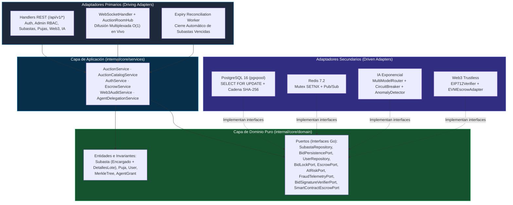

# Enfoque Arquitectónico — LiveBid

> **Proyecto:** LiveBid — Plataforma de Subastas en Tiempo Real  
> **Capa:** Arquitectura de Software · **Versión:** 3.0

Mientras que el *Estilo Arquitectónico* define la topología macro del sistema (separación *Hot Path / Cold Path*, difusión orientada a eventos, capa Web3 y capa de IA), el **Enfoque Arquitectónico** establece cómo se estructura el código y se gobiernan las dependencias *dentro* del servicio principal en **Go 1.23+**.

Para LiveBid hemos adoptado **Arquitectura Hexagonal (Puertos y Adaptadores) / Clean Architecture** en todo el backend [`tecnologia/livebid-backend`](file:///home/fernando/Softwar_Architect/PlataformaSubastas-arquitSoft-02-Fernando/tecnologia/livebid-backend).

---

## 1. Regla de Dependencia Estricta en Go

La regla fundamental es que **las dependencias apuntan siempre hacia adentro (hacia el Dominio)**:
- El paquete `internal/core/domain` contiene únicamente estructuras, tipos de valor, errores de negocio, árbol de Merkle puro y definiciones de interfaces (`ports.go`). **No importa ningún paquete de infraestructura ni de terceros**.
- El paquete `internal/core/services` implementa los casos de uso (`AuctionService`, `AuctionCatalogService`, `AuthService`, `EscrowService`, `Web3AuditService`, `AgentDelegationService`) dependiendo únicamente de `domain`.
- Los paquetes bajo `internal/adapters/*` (`handlers`, `persistence`, `realtime`, `security`, `ai`, `web3`) implementan las interfaces del dominio e inyectan las tecnologías concretas en [`cmd/server/main.go`](file:///home/fernando/Softwar_Architect/PlataformaSubastas-arquitSoft-02-Fernando/tecnologia/livebid-backend/cmd/server/main.go).

| Capa Hexagonal | Ubicación en el Proyecto | ¿Qué contiene? |
|---|---|---|
| **Dominio (Núcleo Puro)** | `internal/core/domain/` | Aggregate Root [`Subasta`](file:///home/fernando/Softwar_Architect/PlataformaSubastas-arquitSoft-02-Fernando/tecnologia/livebid-backend/internal/core/domain/auction.go) (con `EncargadoSubasta`, `DetallesLote`, tramos y *Anti-Sniping*), [`Puja`](file:///home/fernando/Softwar_Architect/PlataformaSubastas-arquitSoft-02-Fernando/tecnologia/livebid-backend/internal/core/domain/bid.go), [`User`](file:///home/fernando/Softwar_Architect/PlataformaSubastas-arquitSoft-02-Fernando/tecnologia/livebid-backend/internal/core/domain/user.go) (roles `POSTOR`, `VENDEDOR`, `MARTILLERO`, `ADMIN`), primitivas [`web3.go`](file:///home/fernando/Softwar_Architect/PlataformaSubastas-arquitSoft-02-Fernando/tecnologia/livebid-backend/internal/core/domain/web3.go) (`ComputeMerkleRoot`), [`ai_agent.go`](file:///home/fernando/Softwar_Architect/PlataformaSubastas-arquitSoft-02-Fernando/tecnologia/livebid-backend/internal/core/domain/ai_agent.go) y puertos en [`ports.go`](file:///home/fernando/Softwar_Architect/PlataformaSubastas-arquitSoft-02-Fernando/tecnologia/livebid-backend/internal/core/domain/ports.go). |
| **Aplicación (Casos de Uso)** | `internal/core/services/` | [`AuctionService`](file:///home/fernando/Softwar_Architect/PlataformaSubastas-arquitSoft-02-Fernando/tecnologia/livebid-backend/internal/core/services/auction_service.go), [`AuctionCatalogService`](file:///home/fernando/Softwar_Architect/PlataformaSubastas-arquitSoft-02-Fernando/tecnologia/livebid-backend/internal/core/services/auction_catalog_service.go), [`AuthService`](file:///home/fernando/Softwar_Architect/PlataformaSubastas-arquitSoft-02-Fernando/tecnologia/livebid-backend/internal/core/services/auth_service.go), [`EscrowService`](file:///home/fernando/Softwar_Architect/PlataformaSubastas-arquitSoft-02-Fernando/tecnologia/livebid-backend/internal/core/services/escrow_service.go), [`Web3AuditService`](file:///home/fernando/Softwar_Architect/PlataformaSubastas-arquitSoft-02-Fernando/tecnologia/livebid-backend/internal/core/services/web3_audit_service.go) y [`AgentDelegationService`](file:///home/fernando/Softwar_Architect/PlataformaSubastas-arquitSoft-02-Fernando/tecnologia/livebid-backend/internal/core/services/agent_delegation_service.go). |
| **Adaptadores Primarios (Entrada)** | `internal/adapters/handlers/`, `internal/adapters/realtime/` | Controladores HTTP REST (`AuthHandler`, `AuctionHandler`, `BidHandler`, `EscrowHandler`, `AgentAIHandler`) y servidor WebSocket (`WebSocketHandler` + `AuctionRoomHub`). |
| **Adaptadores Secundarios (Salida)** | `internal/adapters/persistence/`, `ai/`, `web3/`, `security/` | Repositorios PostgreSQL (`pgxpool`), caché decorador (`CachedUserRepository`), locks/PubSub Redis, router IA (`MultiModelRouter`, `CircuitBreaker`, `AsyncAnomalyDetector`) y verificadores Web3 (`EIP712Verifier`, `EVMEscrowAdapter`). |

---

## 2. Diagrama del Enfoque Hexagonal en LiveBid

