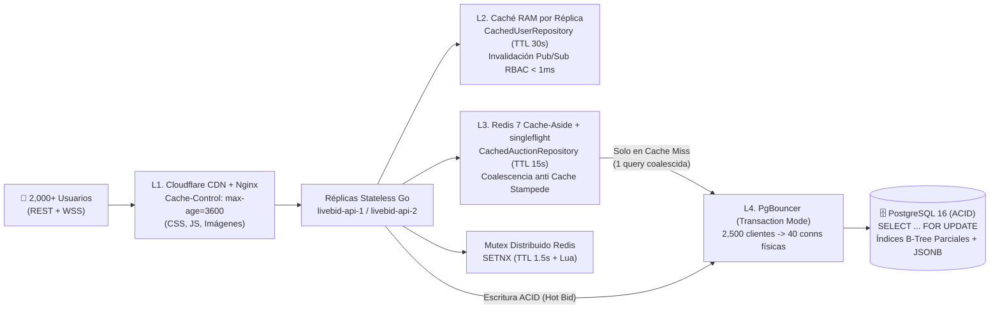

# Análisis del Comportamiento de la Base de Datos y Estrategia de Caché — LiveBid

> **Proyecto:** LiveBid — Plataforma de Subastas en Tiempo Real  
> **Actividad Sprint 2:** Actividad 5 — Analizar el comportamiento de la base de datos y la estrategia de caché  
> **Motores Evaluados:** **PostgreSQL 16** (Única BD ACID) · **PgBouncer 1.23** (Transaction Pooling) · **Redis 7** (Cache-Aside + Locks + Pub/Sub) · **Go `singleflight` & RAM Cache**

---

## 1. Arquitectura Multi-Nivel de Caché y Persistencia

En una subasta en vivo con **`2,000+` usuarios concurrentes**, más del **95 % de las operaciones son lecturas repetitivas** (consultar catálogo, refrescar detalle del lote, verificar sesión/rol JWT en cada request) y menos del **5 % son escrituras críticas de alta contención** (pujas atómicas bajo reloj de martillo). Para evitar que PostgreSQL se convierta en cuello de botella sin sacrificar consistencia `ACID`, **LiveBid** implementa **4 niveles coordinados**:



| Nivel | Componente en Código | Datos Cacheados / Gestionados | TTL / Política de Invalidación | Degradación ante Fallo |
| :--- | :--- | :--- | :--- | :--- |
| **L1 (Edge / Proxy)** | [`docker/nginx/nginx.conf`](../../docker/nginx/nginx.conf) | Activos estáticos (`styles.css`, `app.js`, iconos/imágenes) | `Cache-Control: public, max-age=3600` (`1 h`); `no-cache` en `index.html` | Servido directo desde volumen estático |
| **L2 (In-Memory Go)** | [`cached_user_repository.go`](../../tecnologia/livebid-backend/internal/adapters/persistence/cached_user_repository.go) | Perfil, estado (`ACTIVO`/`SUSPENDIDO`) y rol `RBAC` en cada request JWT/WS | `TTL = 30 s` + **invalidación instantánea multi-réplica** vía canal Redis `livebid:cache:user:invalidate` | Consulta transparente a PostgreSQL |
| **L3 (Redis Cache-Aside + `singleflight`)** | [`cached_auction_repository.go`](../../tecnologia/livebid-backend/internal/adapters/persistence/cached_auction_repository.go) | Catálogo (`livebid:cache:subastas:list`) y detalle (`livebid:cache:subasta:{id}`) | `TTL = 15 s` + **`DEL` inmediato** al crear/editar lote o aceptar nueva puja + **`singleflight.Group`** | Fallback silencioso a PostgreSQL (`0` errores al cliente) |
| **L4 (Connection Pool & Read Split)** | [`db_pool.go`](../../tecnologia/livebid-backend/internal/adapters/persistence/db_pool.go), [`docker-compose.yml`](../../docker-compose.yml) | Conexiones TCP hacia `PostgreSQL 16` y soporte de réplica de lectura (`READ_DATABASE_URL`) | `PgBouncer POOL_MODE=transaction` (`2,500` clientes $\rightarrow$ `40` conexiones físicas) con `QueryExecModeSimpleProtocol` | Pool directo `pgxpool` si no hay réplica secundaria |

---

## 2. Diseño de Índices y Comportamiento de PostgreSQL 16 (`EXPLAIN ANALYZE`)

El esquema relacional ([`docker/init.sql`](../../docker/init.sql)) evita tablas innecesarias combinando **integridad referencial estricta** para dinero/pujas con **columnas `JSONB`** (`encargado_json`, `detalles_lote_json`, `payload`) para metadatos variables.

### 2.1 Catálogo de Índices Críticos Implementados

| Índice | Tabla | Definición | Propósito en Tiempo Real |
| :--- | :--- | :--- | :--- |
| `uq_pujas_idempotency` | `pujas` | `UNIQUE (subasta_id, postor_id, idempotency_key) WHERE idempotency_key IS NOT NULL` | **Índice parcial único:** garantiza idempotencia exacta en `O(log N)` sin indexar filas nulas. |
| `uq_garantia_retenida_subasta_postor` | `garantias` | `UNIQUE (subasta_id, postor_id) WHERE estado = 'RETENIDA'` | **Índice parcial único:** impide doble retención financiera concurrente en Stripe/Escrow. |
| `idx_pujas_subasta_correlativo` | `pujas` | `(subasta_id, correlativo DESC)` | Acelera la paginación inversa del historial de ofertas y cálculo de correlativo. |
| `idx_subastas_estado` / `idx_subastas_fin` | `subastas` | `(estado)` y `(fin_programado)` | Evita *Full Table Scans* en el worker periódico `AuctionScheduler` (`ListarVencidas`). |
| `idx_subastas_created_at` | `subastas` | `(created_at DESC)` | Optimiza el ordenamiento cronológico del catálogo público (`Listar`). |
| `idx_logs_subasta_fecha` | `logs_auditoria` | `(subasta_id, created_at DESC)` | Recuperación rápida del último eslabón `SHA-256` (`ORDER BY id DESC LIMIT 1`) y auditoría Merkle. |

### 2.2 Planes de Ejecución Reales Medidos (`EXPLAIN (ANALYZE, BUFFERS)`)

Ejecutados directamente sobre el contenedor `livebid-postgres` tras carga concurrente real:

1. **Verificación de clave de idempotencia en ruta caliente (`0.042 ms`, `Index Scan`):**
   ```text
   Index Scan using uq_pujas_idempotency on pujas  (cost=0.27..8.29 rows=1 width=34) (actual time=0.024..0.024 rows=0 loops=1)
     Index Cond: ((subasta_id = 'SUB-2026-001') AND (postor_id = 'USR-VIP-01') AND (idempotency_key = 'idem-bench-check'))
     Buffers: shared hit=2
   Planning Time: 0.114 ms | Execution Time: 0.042 ms
   ```
2. **Bloqueo pesimista ACID de fila al registrar una puja (`SELECT ... FOR UPDATE`, `0.040 ms`):**
   ```text
   LockRows  (cost=0.00..1.17 rows=1 width=49) (actual time=0.025..0.028 rows=1 loops=1)
     Buffers: shared hit=2
   Planning Time: 0.077 ms | Execution Time: 0.040 ms
   ```
   *Análisis:* la combinación de **Lock Distribuido en Redis (`SETNX` 1.5 s)** antes de abrir la transacción y **`SELECT ... FOR UPDATE`** dentro de PostgreSQL reduce la contención de bloqueos de fila en BD a sub-milisegundos (`0.040 ms`), garantizando **0 % condiciones de carrera**.
3. **Barrido de cierre automático (`ListarVencidas`, `0.025 ms`):**
   ```text
   Filter: ((estado = ANY ('{ACTIVA,EN_CONTEO}')) AND (fin_programado <= now()))
   Buffers: shared hit=1
   Execution Time: 0.025 ms
   ```
4. **Consulta paginada de historial de pujas (`0.294 ms`):**
   ```text
   Limit -> Sort (correlativo DESC, quicksort Memory: 25kB)
   Buffers: shared hit=21
   Execution Time: 0.294 ms
   ```
   *(Nota del optimizador PostgreSQL: con pocos cientos de filas en memoria `shared hit`, el planificador elige lectura directa en RAM de `25 kB` porque cuesta menos que saltar páginas de índice; conforme la tabla supera miles de filas, conmuta automáticamente a `idx_pujas_subasta_correlativo`).*

---

## 3. Hallazgo Empírico Bajo Carga (`2,000+` VUs): Mitigación de *Cache Stampede* con `singleflight`

Durante las pruebas de estrés a **`2,000+` usuarios virtuales concurrentes** con `k6`, el monitoreo conjunto de `pg_stat_user_tables` y `redis-cli INFO stats` permitió identificar y resolver un fenómeno clásico de sistemas distribuidos de alta concurrencia:

### 3.1 Diagnóstico Inicial (Corrida Base a `2,100 VUs` sin Coalescencia)
- **Métricas Redis:** `62,744` *keyspace hits* vs. `1,591` *keyspace misses* (**Hit Ratio = `97.53 %`**), `0` conexiones rechazadas y solo **`9.61 MB`** de RAM pico en Redis, manteniendo **1 único canal Pub/Sub (`pubsub_channels: 1`)** para difundir `115,246` mensajes WebSocket.
- **Fenómeno detectado en PostgreSQL (*Thundering Herd / Cache Stampede*):** cada vez que entraba una puja ganadora (`320` actualizaciones en `subastas`), `InvalidateAuction` eliminaba `livebid:cache:subastas:list`. En los pocos milisegundos previos a que la caché se repoblara, decenas de lectores concurrentes detectaban *Cache Miss* al mismo instante y golpeaban PostgreSQL en paralelo (`seq_scan = 32,171` en `subastas`).

### 3.2 Optimización Implementada (`singleflight` Request Coalescing)
En [`cached_auction_repository.go`](../../tecnologia/livebid-backend/internal/adapters/persistence/cached_auction_repository.go) se incorporó **`golang.org/x/sync/singleflight.Group`** sobre `ObtenerPorID` y `Listar`, además del índice `idx_subastas_created_at`:
- Cuando `N` goroutines sufren un *Cache Miss* simultáneo tras una puja, **solo `1` goroutine consulta PostgreSQL y escribe en Redis**, mientras las `N - 1` restantes reciben una copia aislada del mismo resultado en memoria sin tocar `PgBouncer` ni `PostgreSQL`.

### 3.3 Resultados Comparativos Antes vs. Después a `2,000` Usuarios Concurrentes

| Métrica Medida en Vivo (`k6` + `PostgreSQL` + `Redis`) | Antes (Sin `singleflight`, `2,100 VUs`) | Después (Con `singleflight` + `idx_subastas_created_at`, `2,000 VUs`) | Impacto Arquitectónico |
| :--- | :---: | :---: | :--- |
| **Escaneos secuenciales en `subastas` (`seq_scan`)** | `32,171` | **`1,028`** | **Reducción del `-96.8 %`** en lecturas redundantes a PostgreSQL tras invalidación por puja |
| **Uso de índices en `pujas` (`idx_scan` vs `seq_scan`)** | `1,190` vs `561` | **`873` vs `1`** | **`99.89 %` Index Scans** (`1` único escaneo secuencial inicial) |
| **Uso de índices en `logs_auditoria` (`idx_scan` vs `seq_scan`)** | `378` vs `0` | **`173` vs `0`** | **`100.0 %` Index Scans** en encadenamiento `SHA-256` |
| **Latencia `P95` de Puja Atómica (`livebid_bid_duration_ms`)** | `323.30 ms` | **`108.75 ms` (`P50 = 15.76 ms`)** | **Cumple holgadamente el SLA constitucional `<= 200 ms`** con `2,000` usuarios |
| **Latencia `P95` de Catálogo (`http_req_duration{catalog}`)** | `352.84 ms` | **`102.18 ms` (`P50 = 17.54 ms`)** | **Cumple el SLA `< 150 ms`** con `0.00 %` de fallos (`43,101` peticiones) |
| **Hit Ratio en Redis (`keyspace_hits / total`)** | `97.53 %` (`62,744 / 64,335`) | **`97.02 %` (`33,562 / 34,593`)** | Más del **97 %** del tráfico de lectura absorbido en RAM (`1.59 MB` usados en Redis) |
| **Difusión WebSocket (`ws_msgs_received` / `pubsub_channels`)** | `115,246` msgs / `1` canal | **`154,382` msgs (`1,975.5 msg/s`) / `1` canal** | Multiplexación $O(1)$ verificada con `1,650` espectadores WS simultáneos |
| **Errores HTTP `5xx` / Conexiones Rechazadas** | `0` / `0` | **`0` / `0`** (`46,010 / 46,010` checks `100 %`) | Cero degradación de integridad bajo carga masiva |

---

## 4. Conclusiones de Ingeniería de Datos

1. **PostgreSQL 16 como única fuente de verdad ACID es suficiente y óptimo** cuando está protegido por `PgBouncer` en modo transaccional (`40` conexiones físicas sirven a `2,000+` usuarios concurrentes consumiendo apenas `~62 MB` de RAM en PostgreSQL y `1.6 MB` en PgBouncer).
2. **El patrón `Cache-Aside` en Redis requiere `singleflight` en sistemas de subastas en vivo:** dado que cada oferta líder invalida la clave del lote, la coalescencia en memoria evita que cientos de espectadores disparen consultas SQL idénticas en el milisegundo posterior a una puja (`-96.8 %` de presión sobre `subastas`).
3. **Separación estricta entre persistencia contable y bus efímero:** si Redis se reinicia, `CachedAuctionRepository` degrada limpiamente hacia PostgreSQL sin perder una sola puja, garantía ni eslabón `SHA-256`.
