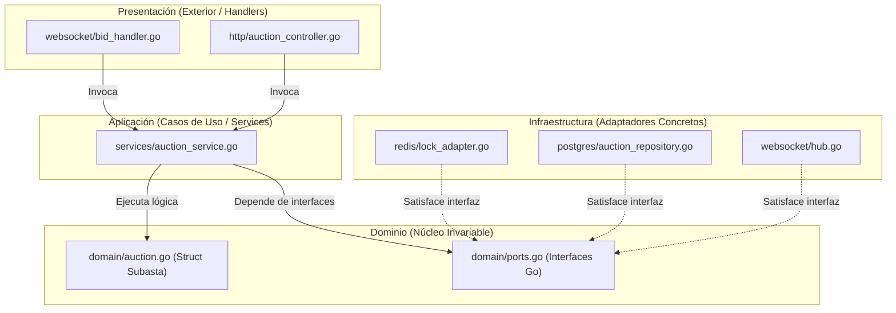

# Diseño interno de módulos — SDD

> **Proyecto:** LiveBid — Plataforma de Subastas en Tiempo Real  
> **Backend:** Go (Golang 1.23+) · **Módulo de referencia:** Subastas y Pujas (*Auction Engine*)  
> **Enfoque arquitectónico:** Clean Architecture (Puertos y Adaptadores / Arquitectura Hexagonal)  
> **Nivel C4:** 4 – Código · **Estándar:** Software Design Description (SDD) · **Versión:** 2.0

---

## 1. Propósito

Este documento de **Descripción de Diseño de Software (SDD)** especifica formalmente cómo se organiza el código dentro del backend en **Go** para LiveBid. Sus objetivos son:

1. **Estandarización técnica en Go:** Asegurar que todos los paquetes del sistema (Usuarios, Catálogo, Subastas, Pagos, Notificaciones) sigan exactamente el layout estándar idiomático de Go (`cmd/` e `internal/`).
2. **Aislamiento de reglas de negocio:** Garantizar que la lógica central de la subasta (validación de incremento, martillazo, anti-sniping) permanezca en structs puros en `domain/`, completamente aislada de frameworks web (Gin/Fiber), librerías de sockets o drivers de bases de datos.
3. **Mantenibilidad y testabilidad con `go test`:** Permitir que cualquier caso de uso pueda ser probado de forma unitaria en memoria mediante mocks de interfaces en microsegundos, sin requerir contenedores ni bases de datos activas.

---

## 2. Estructura Estándar del Proyecto en Go

```text
livebid-backend/
├── cmd/
│   └── server/
│       └── main.go                             // Punto de entrada: Inyección de dependencias e inicio de HTTP/WS
├── internal/
│   ├── core/                                   // Núcleo del Negocio (Independiente de tecnología externa)
│   │   ├── domain/
│   │   │   ├── auction.go                      // Struct Subasta (Aggregate Root) con métodos de negocio
│   │   │   ├── bid.go                          // Struct Puja (Value Object inmutable)
│   │   │   ├── auction_state.go                // Constantes y State Machine de la subasta
│   │   │   ├── increment_rule.go               // Lógica de cálculo de tramos de incremento mínimo
│   │   │   ├── ports.go                        // Interfaces de salida: SubastaRepository, BidLockPort, EscrowPort, etc.
│   │   │   └── errors.go                       // Errores de dominio (ErrPujaInferior, ErrSubastaCerrada, etc.)
│   │   └── services/
│   │       ├── auction_service.go              // Casos de uso: ProcesarPuja, IniciarSubasta, MartillarSubasta
│   │       └── escrow_service.go               // Caso de uso: Retención preventiva y liquidación de garantías
│   └── adapters/                               // Capa de Infraestructura y Presentación (Tecnologías concretas)
│       ├── handlers/
│       │   ├── http/
│       │   │   ├── auction_controller.go       // Endpoints REST /api/v1/subastas
│       │   │   └── middleware/
│       │   │       └── auth_jwt.go             // Validación de token JWT y claims de usuario
│       │   └── websocket/
│       │       ├── hub.go                      // Gestor de salas y difusión concurrente de mensajes
│       │       ├── client.go                   // Goroutines readPump y writePump por postor conectado
│       │       └── bid_handler.go              // Manejador del frame de puja en tiempo real
│       ├── persistence/
│       │   ├── postgres/
│       │   │   ├── auction_repository.go       // Implementación de SubastaRepository con pgxpool
│       │   │   └── models.go                   // Mapeo relacional de base de datos
│       │   └── redis/
│       │       ├── lock_adapter.go             // Implementación de BidLockPort usando SETNX / Redlock
│       │       └── cache_adapter.go            // Lecturas y escrituras ultrarrápidas de precio en caliente
│       ├── ai/
│       │   └── gemini_circuit_breaker.go       // Adaptador de riesgo Gemini con Circuit Breaker en memoria
│       └── payments/
│           └── stripe_niubiz_adapter.go        // Adaptador de pasarela bancaria externa
├── pkg/                                        // Utilidades compartidas reutilizables (logger, config, validator)
│   ├── logger/
│   └── config/
├── go.mod
└── go.sum
```

---

## 3. Responsabilidad por Capa (Regla de Dependencias en Go)



- **Inversión de Dependencias Idiomática en Go:** En Go, los paquetes no necesitan declarar explícitamente `implements Interface`. Si un struct en `redis/lock_adapter.go` implementa el método `AdquirirLock(ctx, id, ttl)`, Go lo reconoce automáticamente como un `BidLockPort`. Esto garantiza **cero acoplamiento**.
- **El paquete `domain` jamás importa nada de `adapters` ni `services`**: Esto previene ciclos de importación (`import cycle not allowed`), una de las mayores fortalezas de Go para forzar una arquitectura limpia.

---

## 4. Flujo de Ejecución del Caso de Uso Crítico: `ProcesarPuja`

1. **Recepción en WebSocket Handler:** La Goroutine de lectura del cliente (`readPump`) recibe el frame JSON: `{"action": "bid", "subasta_id": "SUB-101", "monto": 55000}`.
2. **Contexto con Timeout:** Se inicializa un contexto con cancelación preventiva: `ctx, cancel := context.WithTimeout(context.Background(), 200*time.Millisecond)`.
3. **Invocación del Servicio:** Se invoca `auctionService.ProcesarPuja(ctx, cmd)`.
4. **Adquisición del Lock Atómico:** El servicio solicita el lock en Redis mediante `r.lockPort.AdquirirLock(ctx, cmd.SubastaID, 1500*time.Millisecond)` evitando que dos Goroutines modifiquen la misma subasta simultáneamente.
5. **Evaluación de Reglas en la Entidad:**
   - La entidad `Subasta` valida que su estado sea `ACTIVA` o `EN_CONTEO`.
   - Verifica: `monto >= subasta.PrecioActual + subasta.CalcularIncrementoMinimo()`.
   - **Anti-Sniping:** Si `subasta.EsUltimosSegundos(time.Now(), 15*time.Second)`, extiende el cierre `+30*time.Second`.
   - Genera el struct `Puja` inmutable.
6. **Actualización de Caché y Liberación de Lock:** Se actualiza el precio líder en Redis y se ejecuta inmediatamente la función diferida `unlock()`.
7. **Difusión por Canal de Go (`chan`):** Se envía el evento de actualización al canal del `Hub`, que lo replica a todos los postores en $< 20$ ms.
8. **Persistencia Desacoplada:** Se envía el evento a una cola o worker en segundo plano para ser persistido en PostgreSQL sin ralentizar la respuesta del WebSocket.

---

## 5. Matriz de Errores de Dominio y Mapeo en Go

| Error de Dominio en Go (`var Err... = errors.New(...)`) | Causa en el Negocio | Código HTTP | Mensaje WebSocket Emitido |
|---|---|---|---|
| `domain.ErrPujaInferior` | La oferta no supera el precio líder más el incremento | `http.StatusConflict` (409) | `{"event":"bid_rejected", "reason":"MONTO_INSUFICIENTE"}` |
| `domain.ErrSubastaCerrada` | El martillo final ya cayó o la subasta no está activa | `http.StatusBadRequest` (400) | `{"event":"bid_rejected", "reason":"SUBASTA_FINALIZADA"}` |
| `domain.ErrGarantiaInsuficiente` | El postor no tiene saldo en custodia congelado | `http.StatusForbidden` (403) | `{"event":"bid_rejected", "reason":"GARANTIA_REQUERIDA"}` |
| `domain.ErrLockTimeout` | Demasiada contención concurrente en Redis | `http.StatusServiceUnavailable` (503) | `{"event":"bid_retry", "reason":"COLISION_CONCURRENTE"}` |
| `domain.ErrRiesgoAltoIA` | El agente de IA detectó comportamiento fraudulento | `http.StatusForbidden` (403) | `{"event":"bid_rejected", "reason":"BLOQUEADO_POR_SEGURIDAD"}` |
