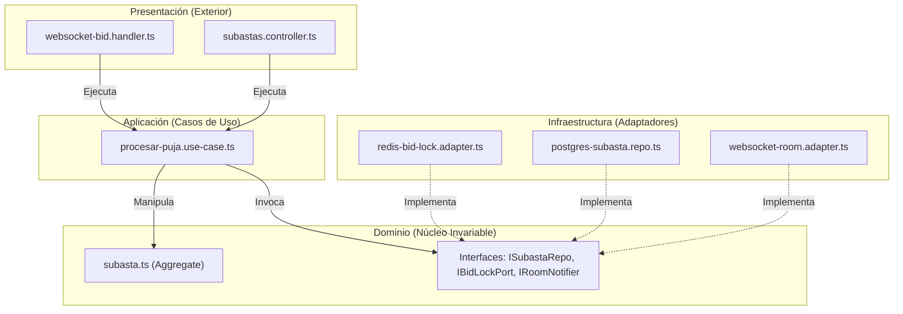

# Diseño interno de módulos — SDD

> **Proyecto:** LiveBid — Plataforma de Subastas en Tiempo Real  
> **Backend:** Node.js + TypeScript · **Módulo de referencia:** Subastas y Pujas (*Bid Engine*)  
> **Enfoque arquitectónico:** Clean Architecture (Puertos y Adaptadores)  
> **Nivel C4:** 4 – Código · **Estándar:** Software Design Description (SDD) · **Versión:** 1.0

---

## 1. Propósito

Este documento de **Descripción de Diseño de Software (SDD)** especifica formalmente cómo se organiza el código dentro de un módulo del backend de LiveBid. Sus objetivos son:

1. **Estandarización técnica:** Asegurar que todos los módulos del sistema (Usuarios, Catálogo, Subastas, Pagos, Notificaciones) sigan exactamente la misma estructura interna.
2. **Aislamiento de reglas de negocio:** Garantizar que la lógica central de la subasta (validación de incremento, martillazo, anti-sniping) permanezca completamente aislada de frameworks web, librerías de sockets o motores de base de datos.
3. **Mantenibilidad y testabilidad:** Permitir que cualquier caso de uso pueda ser probado de forma unitaria en memoria sin levantar servidores ni conexiones reales a bases de datos.

---

## 2. Estructura de Carpetas del Módulo

```text
src/
└── modules/
    └── subastas/
        ├── dominio/
        │   ├── subasta.ts                       // Entidad raíz (Aggregate Root) y reglas de negocio
        │   ├── puja.ts                          // Entidad / Value Object de la oferta realizada
        │   ├── estado-subasta.ts                // Enumeración de estados (State Machine)
        │   ├── regla-incremento.ts              // Objeto de valor que calcula el incremento mínimo
        │   ├── subasta-repository.ts            // Puerto (interfaz) para persistencia
        │   ├── bid-lock-port.ts                 // Puerto para control de concurrencia atómica
        │   ├── escrow-port.ts                   // Puerto para retención de fondos en custodia
        │   ├── room-notifier-port.ts            // Puerto para difusión en tiempo real
        │   └── errores/
        │       ├── puja-inferior.error.ts       // Error de dominio: oferta no supera el precio líder
        │       ├── subasta-cerrada.error.ts     // Error de dominio: lote ya adjudicado o cerrado
        │       └── garantia-insuficiente.error.ts // Error de dominio: postor sin saldo en custodia
        ├── aplicacion/
        │   ├── procesar-puja.use-case.ts        // Caso de uso crítico: recepción y validación de puja
        │   ├── procesar-puja.command.ts         // DTO de entrada tipado para la puja
        │   ├── procesar-puja.response.ts        // DTO de salida con el nuevo estado del lote
        │   ├── iniciar-subasta.use-case.ts      // Caso de uso: apertura de sala y cronómetro
        │   └── martillar-subasta.use-case.ts    // Caso de uso: transición de martillo y cierre
        ├── infraestructura/
        │   ├── redis-bid-lock.adapter.ts        // Implementación atómica con Redis Mutex
        │   ├── postgres-subasta.repo.ts         // Implementación persistente con PostgreSQL
        │   ├── websocket-room.adapter.ts        // Implementación de difusión mediante Socket.io/WS
        │   └── niubiz-escrow.adapter.ts         // Implementación de verificación de fondos con Niubiz
        └── presentacion/
            ├── websocket-bid.handler.ts         // Receptor de eventos de sockets ('puja:emitir')
            ├── subastas.controller.ts           // Controlador HTTP para operaciones administrativas
            ├── subastas.routes.ts               // Mapeo de rutas REST /api/v1/subastas
            └── dtos/
                └── emitir-puja.dto.ts           // Validación de payload HTTP/WS con class-validator
```

---

## 3. Responsabilidad por Capa (Regla de Dependencias)



- **Regla de oro:** Las flechas de código siempre apuntan **hacia adentro**. El `dominio` no importa nada de `aplicacion`, `infraestructura` ni `presentacion`.
- **Inversión de Dependencias (DIP):** El caso de uso (`aplicacion`) solo conoce interfaces del `dominio`. Las clases de `infraestructura` implementan dichas interfaces y se inyectan en tiempo de ejecución.

---

## 4. Flujo de Ejecución del Caso de Uso Crítico: `ProcesarPuja`

1. **Recepción en Presentación:** El cliente emite por WebSocket `{ subastaId: "SUB-101", monto: 5500, postorId: "USR-88" }`. El `websocket-bid.handler` valida el formato sintáctico y el token JWT de la sesión.
2. **Invocación del Caso de Uso:** Se construye el comando `ProcesarPujaCommand` y se delega al `ProcesarPujaUseCase.ejecutar(cmd)`.
3. **Validación de Garantía (Escrow):** Se consulta al puerto `IEscrowPort.validarGarantiaActiva(cmd.postorId, cmd.subastaId)`. Si no cumple, lanza `GarantiaInsuficienteError`.
4. **Adquisición de Lock Atómico:** Se invoca `IBidLockPort.adquirirLock(cmd.subastaId)` en Redis para evitar condiciones de carrera (Race Condition).
5. **Evaluación de Reglas en Dominio:** 
   - La entidad `Subasta` valida que su estado sea `ACTIVA` o `EN_CONTEO`.
   - Comprueba que `monto >= precioActual + incrementoMinimo`.
   - Si la puja entra en los últimos 15 segundos, extiende el cronómetro 30 segundos más (*Anti-Sniping*).
   - Genera la entidad inmutable `Puja` con timestamp del servidor.
6. **Persistencia y Liberación de Lock:** Se persiste el nuevo estado mediante `ISubastaRepository.guardar(subasta)` y se libera el lock atómico en Redis.
7. **Notificación en Tiempo Real:** Se invoca `IRoomNotifierPort.difundirNuevaPuja(nuevaPuja)` notificando a todos los postores en $< 50$ ms.

---

## 5. Matriz de Errores de Dominio y Mapeo de Respuesta

| Error de Dominio | Causa en el Negocio | Código HTTP | Evento WebSocket Retornado |
|---|---|---|---|
| `PujaInferiorError` | La oferta no supera el precio líder más el incremento mínimo | 409 Conflict | `puja:rechazada { motivo: "MONTO_INSUFICIENTE" }` |
| `SubastaCerradaError` | El martillo final ya cayó o la subasta no ha iniciado | 400 Bad Request | `puja:rechazada { motivo: "SUBASTA_FINALIZADA" }` |
| `GarantiaInsuficienteError` | El postor no tiene saldo en custodia congelado | 403 Forbidden | `puja:rechazada { motivo: "GARANTIA_REQUERIDA" }` |
| `LockTimeoutError` | Demasiada contención concurrente temporal en Redis | 503 Service Unavailable | `puja:reintentar { motivo: "COLISION_CONCURRENTE" }` |

