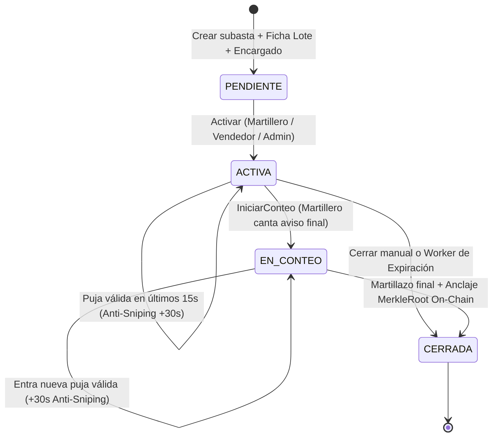

# Patrones de diseño — LiveBid

> **Proyecto:** LiveBid — Plataforma de Subastas en Tiempo Real  
> **Capa:** Diseño Interno de Software · **Nivel C4:** 4 – Código  
> **Lenguaje Oficial:** Go 1.23+ · **Versión:** 3.0

---

## 1. Objetivo

Documentar los patrones de diseño GoF, de concurrencia y de arquitectura cloud-native implementados en el backend de **LiveBid** ([`tecnologia/livebid-backend`](file:///home/fernando/Softwar_Architect/PlataformaSubastas-arquitSoft-02-Fernando/tecnologia/livebid-backend)), detallando el problema que resuelven y los archivos exactos donde residen.

---

## 2. Catálogo de Patrones Aplicados en Go

| Patrón | Categoría | Problema que Resuelve en LiveBid | Implementación en Go 1.23+ | Archivos Reales en el Repositorio |
|---|---|---|---|---|
| **Aggregate Root & State Machine** | Dominio (DDD / Comportamiento) | Evitar estados inconsistentes al validar pujas, extensiones *Anti-Sniping*, cambios a `EN_CONTEO` y cierre. | Struct `Subasta` y tipo `EstadoSubasta` con métodos de transición blindados (`Activar`, `IniciarConteo`, `Cerrar`, `ValidarYRegistrarPuja`). | [`internal/core/domain/auction.go`](file:///home/fernando/Softwar_Architect/PlataformaSubastas-arquitSoft-02-Fernando/tecnologia/livebid-backend/internal/core/domain/auction.go), [`auction_state.go`](file:///home/fernando/Softwar_Architect/PlataformaSubastas-arquitSoft-02-Fernando/tecnologia/livebid-backend/internal/core/domain/auction_state.go) |
| **Multiplexed Observer / Pub-Sub Hub** | Concurrencia & Tiempo Real | Evitar abrir $N$ conexiones Redis Pub/Sub cuando $N$ usuarios observan la misma subasta en vivo. | `AuctionRoomHub` suscribe **1 sola vez por sala activa** a Redis y reparte el mensaje a los canales locales de cada socket. | [`internal/adapters/realtime/room_hub.go`](file:///home/fernando/Softwar_Architect/PlataformaSubastas-arquitSoft-02-Fernando/tecnologia/livebid-backend/internal/adapters/realtime/room_hub.go), [`redis_bid_notifier.go`](file:///home/fernando/Softwar_Architect/PlataformaSubastas-arquitSoft-02-Fernando/tecnologia/livebid-backend/internal/adapters/realtime/redis_bid_notifier.go) |
| **Circuit Breaker con Fallback** | Resiliencia / Estabilidad | Impedir que una caída o latencia $>150\text{ ms}$ en la API de Google Gemini bloquee el *Hot Path* de la subasta. | Máquina de estados atómica (`CLOSED`, `OPEN`, `HALF-OPEN`) que conmuta automáticamente a heurística local determinista. | [`internal/adapters/ai/circuit_breaker.go`](file:///home/fernando/Softwar_Architect/PlataformaSubastas-arquitSoft-02-Fernando/tecnologia/livebid-backend/internal/adapters/ai/circuit_breaker.go), [`gemini_risk_adapter.go`](file:///home/fernando/Softwar_Architect/PlataformaSubastas-arquitSoft-02-Fernando/tecnologia/livebid-backend/internal/adapters/ai/gemini_risk_adapter.go) |
| **Strategy & Hot-Swap Router** | Comportamiento / IA Exponencial | Permitir cambiar en caliente el modelo de IA (`gemini-2.5-flash` $\leftrightarrow$ `gemini-2.5-pro`) y la estrategia de puja de Agentes IA. | `MultiModelRouter` protegido por `sync.RWMutex` y estrategias de `AgentStrategy` (`CONSERVADORA`, `EQUILIBRADA`, `SNIPER`). | [`internal/adapters/ai/multi_model_router.go`](file:///home/fernando/Softwar_Architect/PlataformaSubastas-arquitSoft-02-Fernando/tecnologia/livebid-backend/internal/adapters/ai/multi_model_router.go), [`domain/ai_agent.go`](file:///home/fernando/Softwar_Architect/PlataformaSubastas-arquitSoft-02-Fernando/tecnologia/livebid-backend/internal/core/domain/ai_agent.go) |
| **Decorator (Read-Through Cache)** | Estructural / Rendimiento | Eliminar la consulta SQL repetitiva a `usuarios` en cada petición HTTP o frame WebSocket autenticado. | `CachedUserRepository` envuelve `UserRepository` con caché en memoria TTL e invalidación inmediata en `UpdateStatus`/`UpdateRole`. | [`internal/adapters/persistence/cached_user_repository.go`](file:///home/fernando/Softwar_Architect/PlataformaSubastas-arquitSoft-02-Fernando/tecnologia/livebid-backend/internal/adapters/persistence/cached_user_repository.go) |
| **Adapter (Puertos y Adaptadores)** | Estructural | Aislar el dominio de los detalles de PostgreSQL, Redis, firmas Web3 EIP-712 y Smart Contracts EVM. | Implementaciones concretas de `BidSignatureVerifierPort`, `SmartContractEscrowPort`, `EscrowPort` y `BidLockPort`. | [`internal/adapters/web3/eip712_verifier.go`](file:///home/fernando/Softwar_Architect/PlataformaSubastas-arquitSoft-02-Fernando/tecnologia/livebid-backend/internal/adapters/web3/eip712_verifier.go), [`evm_escrow_adapter.go`](file:///home/fernando/Softwar_Architect/PlataformaSubastas-arquitSoft-02-Fernando/tecnologia/livebid-backend/internal/adapters/web3/evm_escrow_adapter.go) |
| **Cryptographic Hash Chain & Merkle Tree** | Seguridad / Integridad Forense | Garantizar que ninguna puja histórica pueda ser alterada, borrada ni reordenada sin romper la prueba matemática. | Cadena de hashes SHA-256 en PostgreSQL + árbol binario de Merkle (`ComputeMerkleRoot` y `GenerateMerkleProof`). | [`internal/core/domain/web3.go`](file:///home/fernando/Softwar_Architect/PlataformaSubastas-arquitSoft-02-Fernando/tecnologia/livebid-backend/internal/core/domain/web3.go), [`postgres_bid_repository.go`](file:///home/fernando/Softwar_Architect/PlataformaSubastas-arquitSoft-02-Fernando/tecnologia/livebid-backend/internal/adapters/persistence/postgres_bid_repository.go) |

---

## 3. Detalle Operativo de los Patrones Críticos

### 3.1 Máquina de Estados del Ciclo de Vida de la Subasta

### 3.2 Patrón Decorator: `CachedUserRepository` con Invalidación Reactiva
Cada endpoint protegido verifica que el usuario exista, esté `ACTIVO` y conserve el `Role` declarado en su JWT. Al aplicar el patrón **Decorator** en [`CachedUserRepository`](file:///home/fernando/Softwar_Architect/PlataformaSubastas-arquitSoft-02-Fernando/tecnologia/livebid-backend/internal/adapters/persistence/cached_user_repository.go), las lecturas se sirven desde memoria RAM en microsegundos, pero cualquier cambio administrativo de rol o estado (`UpdateStatus`, `UpdateRole`, `Save`) invalida de inmediato la entrada en caché, combinando **rendimiento extremo** con **revocación Zero-Trust instantánea**.
