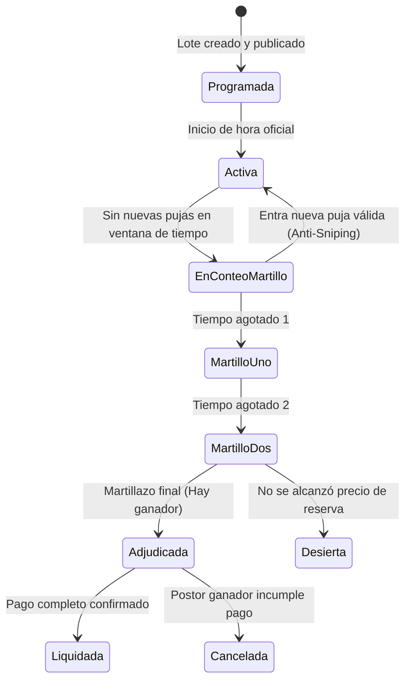

# Patrones de diseño — LiveBid

> **Proyecto:** LiveBid — Plataforma de Subastas en Tiempo Real  
> **Capa:** Diseño Interno de Software · **Nivel C4:** 4 – Código  
> **Estándar:** Software Design Description (SDD) · **Versión:** 1.0

---

## 1. Objetivo

Documentar los patrones de diseño aplicados en el backend de **LiveBid**, especificando el problema que resuelven, en qué módulo se ubican, la tecnología con la que se implementan y los archivos de código donde residen, garantizando uniformidad y calidad en el desarrollo.

---

## 2. Patrones de Diseño Aplicados

| Patrón | Dónde se usa | Problema que resuelve | Cómo se implementa | Archivos en el código |
|---|---|---|---|---|
| **State (Comportamiento)** | Subastas → Ciclo de vida del lote | Evitar condicionales infinitos (`if/else`) para validar qué operaciones son válidas según el momento de la subasta | Clases de estado que heredan de `EstadoSubasta` (`ActivaState`, `MartilloState`, `AdjudicadaState`) | `dominio/estado-subasta.ts`, `dominio/estados/` |
| **Observer / Pub-Sub (Comportamiento)** | Motor de Pujas → Clientes en Vivo | Notificar a cientos de postores conectados en la sala sin acoplar el caso de uso con la librería de WebSockets | Puerto `IRoomNotifierPort` + Redis Pub/Sub + Socket.io | `dominio/room-notifier-port.ts`, `infraestructura/websocket-room.adapter.ts` |
| **Adapter (Estructural)** | Pagos → Pasarela bancaria (Niubiz/Stripe) | La pasarela externa tiene su propio SDK y protocolo que no deben contaminar el dominio | Adaptador que implementa `IPaymentEscrowPort` traduciendo DTOs | `dominio/escrow-port.ts`, `infraestructura/niubiz-escrow.adapter.ts` |
| **Repository (Estructural)** | Todos los módulos → Base de datos | El negocio no debe conocer tablas, sintaxis SQL ni detalles de PostgreSQL | Interfaz en Dominio implementada con TypeORM / Prisma / pg | `dominio/subasta-repository.ts`, `infraestructura/postgres-subasta.repo.ts` |
| **Circuit Breaker (Estabilidad)** | Pagos y Servicios Externos (Reniec/KYC) | Si la pasarela de pagos o el servicio de identidad falla, evitar que colapse el backend por timeouts | Librería Opossum / Resilence4j que abre el circuito temporalmente | `infraestructura/circuit-breaker.middleware.ts` |
| **Command (Comportamiento)** | Presentación → Aplicación | Encapsular la intención de puja como un objeto inmutable para permitir encolamiento FIFO y auditoría | Objeto `ProcesarPujaCommand` validado con tipado estricto | `aplicacion/procesar-puja.command.ts` |

---

## 3. Detalle Operativo de los Patrones Clave

### 3.1 Patrón State: Ciclo de Vida de la Subasta
Una subasta pasa por estados estrictos con transiciones controladas:



- **Ventaja:** Cada estado encapsula su propio comportamiento. Por ejemplo, en `AdjudicadaState.pujar()`, el método arroja automáticamente `SubastaCerradaError` sin necesidad de evaluar múltiples banderas booleanas.

### 3.2 Patrón Adapter: Aislamiento de Pasarelas de Pago
- El dominio define la interfaz:
  ```typescript
  export interface IPaymentEscrowPort {
    retenerGarantia(postorId: string, subastaId: string, monto: number): Promise<ResultadoRetencion>;
    liberarGarantia(retencionId: string): Promise<void>;
    capturarFondosGanador(retencionId: string): Promise<ResultadoCobro>;
  }
  ```
- Si en el futuro se reemplaza Niubiz por Stripe o Culqi, el caso de uso `ProcesarPujaUseCase` **no sufre ninguna modificación**.

### 3.3 Patrón Observer: Difusión de Precios a Milisegundos
- Cuando entra una puja válida, el caso de uso publica el evento de dominio `PujaAceptadaEvent`.
- El adaptador `WebSocketRoomAdapter` escucha este evento y lo serializa hacia el canal de Redis:
  ```typescript
  redisClient.publish(`sala:${subastaId}`, JSON.stringify(evento));
  ```
- Todos los nodos del cluster reciben el mensaje y emiten el evento `sala:nuevo_precio` a sus respectivos sockets locales en $< 30$ ms.

---

## 4. Beneficios para el Proyecto LiveBid

1. **Alta Concurrencia sin Caídas:** El patrón Circuit Breaker y el desacoplamiento Pub-Sub protegen la base de datos central de avalanchas de lecturas.
2. **Auditabilidad Legal:** El patrón Command garantiza que cada puja quede registrada como una transacción discreta con firma y sello de tiempo.
3. **Evolución sin Riesgo:** Cambiar la base de datos o el proveedor de pagos es solo cuestión de programar un nuevo adaptador sin tocar el motor de pujas.

