# Principios de diseño (SOLID) — LiveBid

> **Proyecto:** LiveBid — Plataforma de Subastas en Tiempo Real  
> **Capa:** Diseño Interno de Software · **Nivel C4:** 4 – Código  
> **Lenguaje Oficial:** Go 1.23+ · **Versión:** 3.0

---

## 1. Objetivo

Documentar cómo se aplican los **cinco principios SOLID** de forma idiomática en el backend en **Go 1.23+** de **LiveBid** ([`tecnologia/livebid-backend`](file:///home/fernando/Softwar_Architect/PlataformaSubastas-arquitSoft-02-Fernando/tecnologia/livebid-backend)).

---

## 2. Aplicación de SOLID en el Backend Go de LiveBid

| Principio | Capa donde se aplica | Cómo se cumple en LiveBid (Go 1.23+) | Archivos Reales de Referencia |
|---|---|---|---|
| **S** · Responsabilidad Única (*Single Responsibility*) | Todas las capas | Cada struct y paquete tiene una única razón de cambio: `AuctionRoomHub` solo multiplexa salas WebSocket; `AuctionService` orquesta pujas; `Subasta` valida invariantes de dominio; `Web3AuditService` genera pruebas Merkle; `PostgresBidRepository` ejecuta transacciones SQL. | [`room_hub.go`](file:///home/fernando/Softwar_Architect/PlataformaSubastas-arquitSoft-02-Fernando/tecnologia/livebid-backend/internal/adapters/realtime/room_hub.go), [`auction_service.go`](file:///home/fernando/Softwar_Architect/PlataformaSubastas-arquitSoft-02-Fernando/tecnologia/livebid-backend/internal/core/services/auction_service.go), [`auction.go`](file:///home/fernando/Softwar_Architect/PlataformaSubastas-arquitSoft-02-Fernando/tecnologia/livebid-backend/internal/core/domain/auction.go), [`web3_audit_service.go`](file:///home/fernando/Softwar_Architect/PlataformaSubastas-arquitSoft-02-Fernando/tecnologia/livebid-backend/internal/core/services/web3_audit_service.go) |
| **O** · Abierto/Cerrado (*Open/Closed*) | Dominio e Infraestructura | El motor de subastas está abierto a nuevos modelos de IA, nuevos verificadores Web3 o nuevos almacenes sin modificar `AuctionService`. Por ejemplo, `MultiModelRouter` permite registrar y activar nuevos proveedores LLM en caliente sin alterar el flujo de puja. | [`multi_model_router.go`](file:///home/fernando/Softwar_Architect/PlataformaSubastas-arquitSoft-02-Fernando/tecnologia/livebid-backend/internal/adapters/ai/multi_model_router.go), [`ports.go`](file:///home/fernando/Softwar_Architect/PlataformaSubastas-arquitSoft-02-Fernando/tecnologia/livebid-backend/internal/core/domain/ports.go) |
| **L** · Sustitución de Liskov (*Liskov Substitution*) | Puertos y Adaptadores | Cualquier implementación de `UserRepository` (`PostgresUserRepository` o su decorador `CachedUserRepository`) o de `AIRiskPort` (`GeminiRiskAdapter`, `CircuitBreaker`, `MultiModelRouter`) es 100% intercambiable sin alterar la semántica esperada por los servicios. | [`cached_user_repository.go`](file:///home/fernando/Softwar_Architect/PlataformaSubastas-arquitSoft-02-Fernando/tecnologia/livebid-backend/internal/adapters/persistence/cached_user_repository.go), [`circuit_breaker.go`](file:///home/fernando/Softwar_Architect/PlataformaSubastas-arquitSoft-02-Fernando/tecnologia/livebid-backend/internal/adapters/ai/circuit_breaker.go) |
| **I** · Segregación de Interfaces (*Interface Segregation*) | Dominio (`ports.go`) | En lugar de una interfaz monolítica, [`domain/ports.go`](file:///home/fernando/Softwar_Architect/PlataformaSubastas-arquitSoft-02-Fernando/tecnologia/livebid-backend/internal/core/domain/ports.go) define interfaces pequeñas y focalizadas al estilo idiomático de Go: `BidLockPort`, `EscrowPort`, `BidNotifierPort`, `AIRiskPort`, `FraudTelemetryPort`, `BidSignatureVerifierPort` y `SmartContractEscrowPort`. | [`internal/core/domain/ports.go`](file:///home/fernando/Softwar_Architect/PlataformaSubastas-arquitSoft-02-Fernando/tecnologia/livebid-backend/internal/core/domain/ports.go) |
| **D** · Inversión de Dependencias (*Dependency Inversion*) | Aplicación e Infraestructura | Los casos de uso en `internal/core/services` dependen exclusivamente de las interfaces definidas en `internal/core/domain`. El ensamblaje concreto (*wiring*) ocurre únicamente en `cmd/server/main.go`. | [`cmd/server/main.go`](file:///home/fernando/Softwar_Architect/PlataformaSubastas-arquitSoft-02-Fernando/tecnologia/livebid-backend/cmd/server/main.go), [`auction_service.go`](file:///home/fernando/Softwar_Architect/PlataformaSubastas-arquitSoft-02-Fernando/tecnologia/livebid-backend/internal/core/services/auction_service.go) |

---

## 3. Diagrama UML de Inversión y Segregación de Interfaces en Go

```mermaid
classDiagram
    direction TB

    class SubastaRepository {
        <<interface>>
        +ObtenerPorID(ctx, id) (*Subasta, error)
        +Listar(ctx) ([]*Subasta, error)
        +ListarVencidas(ctx, now) ([]*Subasta, error)
        +Guardar(ctx, subasta) error
    }
    class BidLockPort {
        <<interface>>
        +AdquirirLock(ctx, subastaID, ttl) (UnlockFunc, error)
    }
    class AIRiskPort {
        <<interface>>
        +EvaluarRiesgo(ctx, postorID, subastaID, monto) (RiskScore, error)
    }
    class BidSignatureVerifierPort {
        <<interface>>
        +VerifyBidSignature(ctx, envelope, subastaID, postorID, monto) error
    }
    class SmartContractEscrowPort {
        <<interface>>
        +VerifyLockedCollateral(ctx, subastaID, postorID, monto) (bool, error)
        +SettleWinnerOnChain(ctx, subastaID, winnerID, monto, merkleRoot) (*OnChainSettlementReceipt, error)
    }

    class AuctionService {
        -repo SubastaRepository
        -lockPort BidLockPort
        -riskPort AIRiskPort
        -sigVerifier BidSignatureVerifierPort
        -web3Escrow SmartContractEscrowPort
        +ProcesarPuja(ctx, cmd) (*ProcesarPujaResult, error)
        +CerrarVencidas(ctx, now) (int, error)
    }

    class PostgresAuctionRepository
    class RedisLockAdapter
    class MultiModelRouter
    class EIP712Verifier
    class EVMEscrowAdapter

    AuctionService --> SubastaRepository : Depende de abstracción (DIP)
    AuctionService --> BidLockPort : Depende de abstracción (DIP)
    AuctionService --> AIRiskPort : Depende de abstracción (DIP)
    AuctionService --> BidSignatureVerifierPort : Depende de abstracción (DIP)
    AuctionService --> SmartContractEscrowPort : Depende de abstracción (DIP)

    PostgresAuctionRepository ..|> SubastaRepository : Satisface implícitamente
    RedisLockAdapter ..|> BidLockPort : Satisface implícitamente
    MultiModelRouter ..|> AIRiskPort : Satisface implícitamente
    EIP712Verifier ..|> BidSignatureVerifierPort : Satisface implícitamente
    EVMEscrowAdapter ..|> SmartContractEscrowPort : Satisface implícitamente
```

