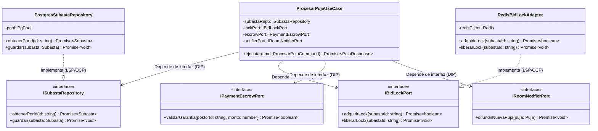

# Principios de diseño (SOLID) — LiveBid

> **Proyecto:** LiveBid — Plataforma de Subastas en Tiempo Real  
> **Capa:** Diseño Interno de Software · **Nivel C4:** 4 – Código  
> **Estándar:** Software Design Description (SDD) · **Versión:** 1.0

---

## 1. Objetivo

Documentar cómo se aplican los **cinco principios de diseño SOLID** en el backend de **LiveBid**, asegurando que el código sea modular, testeable, desacoplado y resistente al cambio ante altas demandas de concurrencia y transaccionalidad.

---

## 2. Aplicación de SOLID en el Módulo de Subastas y Pujas

| Principio | Capa donde se aplica | Cómo se cumple en LiveBid | Archivos de Referencia |
|---|---|---|---|
| **S** · Responsabilidad Única (*Single Responsibility*) | Todas las capas | Cada clase tiene una única razón de cambio: el controlador de sockets gestiona la conexión de red, el caso de uso orquesta la validación de la puja, la entidad `Subasta` aplica las reglas de negocio e incrementos, y el repositorio maneja la persistencia SQL. | `websocket-bid.handler.ts`, `procesar-puja.use-case.ts`, `subasta.ts`, `postgres-subasta.repo.ts` |
| **O** · Abierto/Cerrado (*Open/Closed*) | Dominio e Infraestructura | El sistema está abierto a la extensión pero cerrado a la modificación. Para admitir un nuevo formato de subasta (ej. Subasta Holandesa descendente), se implementa una nueva estrategia de incremento y estado sin modificar `ProcesarPujaUseCase`. Para agregar PayPal, se añade un adaptador nuevo. | `regla-incremento.ts`, `niubiz-escrow.adapter.ts`, `stripe-escrow.adapter.ts` |
| **L** · Sustitución de Liskov (*Liskov Substitution*) | Infraestructura y Puertos | Cualquier implementación de `IPaymentEscrowPort` (Niubiz, Stripe o Mock en memoria) puede sustituir a otra sin que el caso de uso `ProcesarPujaUseCase` falle ni perciba la diferencia en los contratos de retención y cobro. | `escrow-port.ts`, `niubiz-escrow.adapter.ts`, `memoria-escrow.adapter.ts` |
| **I** · Segregación de Interfaces (*Interface Segregation*) | Dominio | Las interfaces son específicas y granulares. El caso de uso de pujas no depende de una mega-interfaz `ISistemaTotal`, sino de interfaces pequeñas y focalizadas: `IBidLockPort` solo adquiere locks, `IPaymentEscrowPort` solo gestiona garantías, e `IRoomNotifierPort` solo emite eventos. | `bid-lock-port.ts`, `escrow-port.ts`, `room-notifier-port.ts` |
| **D** · Inversión de Dependencias (*Dependency Inversion*) | Aplicación e Infraestructura | Los módulos de alto nivel (casos de uso) no dependen de módulos de bajo nivel (PostgreSQL, Redis, Socket.io). Ambos dependen de abstracciones (interfaces del dominio). Las dependencias concretas se inyectan en el módulo de inicialización (`subastas.module.ts`). | `procesar-puja.use-case.ts`, `subasta-repository.ts`, `subastas.module.ts` |

---

## 3. Comparativa: Con SOLID vs. Sin SOLID en LiveBid

| Escenario Real en LiveBid | Sin SOLID | Con SOLID (Diseño LiveBid) |
|---|---|---|
| **La pasarela Niubiz experimenta latencia o cambia su API** | El programador debe modificar el código de la sala de pujas, arriesgando caídas en vivo. | Solo se ajusta la clase `NiubizEscrowAdapter`. El motor de subastas ni se entera del cambio. |
| **Se ejecutan pruebas unitarias de concurrencia** | Se necesita tener levantado un cluster real de Redis y PostgreSQL con red activa. | Se inyectan `MemoriaBidLockAdapter` y `MemoriaSubastaRepository` ejecutando 1,000 tests en milisegundos. |
| **Se crea una subasta con incremento dinámico porcentual** | Se llena el caso de uso de bloques `switch/case` e `if` anidados propensos a bugs. | Se crea una clase `IncrementoPorcentualStrategy` que implementa `IReglaIncremento`. |
| **Se cae el broker de RabbitMQ** | El backend colapsa porque las llamadas al broker están acopladas directamente al controlador. | El adaptador maneja la contingencia o conmuta a almacenamiento local temporal sin tumbar la puja. |

---

## 4. Trazabilidad con Clean Architecture

