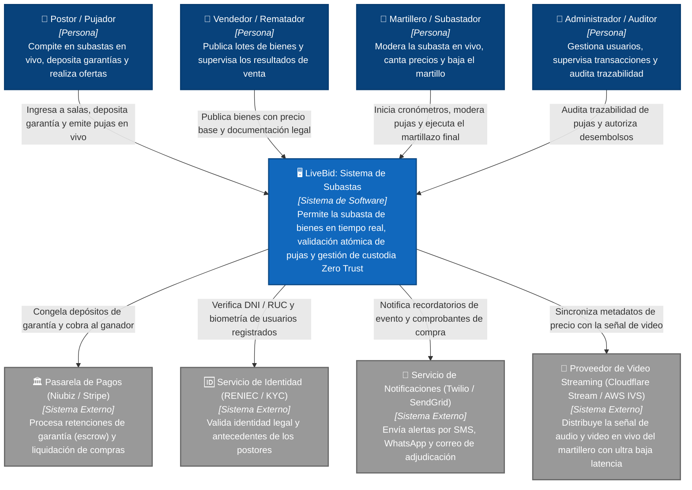

# Nivel 1 · Diagrama de contexto del sistema — LiveBid

> **Proyecto:** LiveBid — Plataforma de Subastas en Tiempo Real  
> **Modelo:** C4 · Nivel 1 de 4 · **Versión:** 1.0  
> **Estándar:** Software Design Description (SDD)

---

## 1. Objetivo

Mostrar la **Plataforma LiveBid como una sola caja (caja negra)**: quiénes interactúan con ella y con qué sistemas externos se comunica. Es la vista de mayor nivel arquitectónico y la base para la sustentación ejecutiva del proyecto.

| Aspecto | Descripción |
|---|---|
| **Pregunta que responde** | ¿Qué es LiveBid, quiénes son sus usuarios y con qué sistemas externos se integra? |
| **Audiencia** | Docentes evaluadores, clientes de negocio, equipo de desarrollo y operaciones |
| **Qué NO muestra** | Tecnologías internas, bases de datos, microservicios ni sockets específicos |
| **Siguiente nivel** | `Nivel2-DiagramadeContenedores.md` |

---

## 2. Diagrama de Contexto (C4 Nivel 1)

---

## 3. Personas (Usuarios del Sistema)

| Persona | Rol | Responsabilidad en LiveBid |
|---|---|---|
| **Postor / Pujador** | Usuario Comprador | Se registra, valida su identidad, constituye un depósito de garantía, ingresa a la sala en vivo y emite ofertas de puja. |
| **Vendedor / Rematador** | Usuario Proveedor | Registra lotes de bienes con precio base, reserva, peritaje técnico y fecha de subasta. |
| **Martillero / Subastador** | Operador en Vivo | Controla el ritmo del remate, valida el martillo 1, 2 y adjudicación final; puede pausar la sala ante contingencias. |
| **Administrador / Auditor** | Operaciones y Cumplimiento | Resuelve controversias, audita logs inmutables de concurrencia y autoriza la liberación de garantías. |

---

## 4. Sistemas Externos

| Sistema Externo | Tipo | Función en la Arquitectura | Protocolo de Integración |
|---|---|---|---|
| **Pasarela de Pagos (Niubiz/Stripe)** | Pasarela Bancaria | Retención preventiva de fondos (*escrow*) y captura final del monto adjudicado. | HTTPS / REST (API firmada) |
| **Servicio de Identidad (RENIEC / KYC)** | Validación Legal | Autenticación de identidad oficial de postores para evitar postores fantasmas. | HTTPS / REST |
| **Servicio de Notificaciones** | Mensajería Externa | Envío de notificaciones transaccionales multicanal (Email, SMS, WhatsApp). | HTTPS / REST (Webhooks) |
| **Proveedor de Streaming de Video** | Distribución Multimedia | Transmisión de video del martillero con latencia $< 1.5$ s hacia el frontend. | WebRTC / LL-HLS |

---

## 5. Decisiones Arquitectónicas y Supuestos de Contexto

1. **Aislamiento de Fondos (Zero Trust):** LiveBid **nunca almacena números de tarjeta ni dinero en cuentas propias**; las transacciones se realizan mediante preautorizaciones bancarias (*hold/capture*) directamente en la pasarela.
2. **Sincronización Video vs. Datos:** El dato de la puja viaja por WebSocket independiente del video para asegurar que la puja se registre en $< 50$ ms aunque el video sufra microcortes de red.
3. **Validez Legal del Timestamp:** La única fuente oficial de orden de llegada es el reloj sincronizado NTP del servidor de LiveBid, rechazando disputas basadas en la hora del teléfono o PC del postor.

