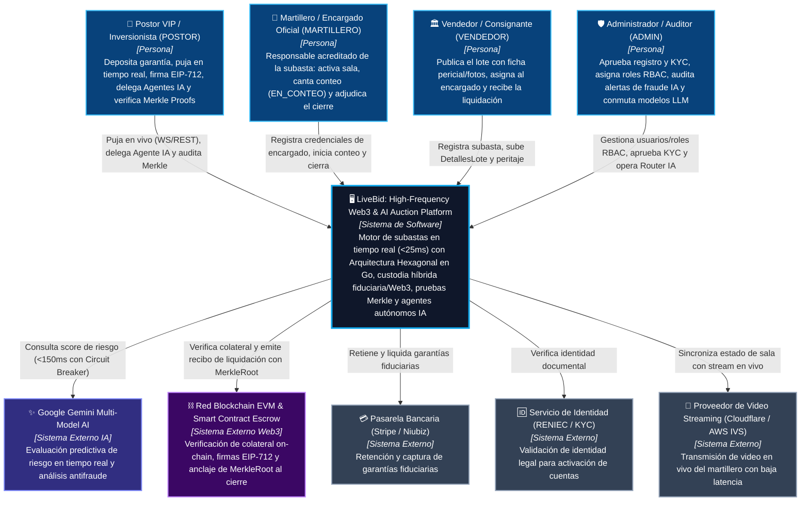

# Nivel 1 · Diagrama de contexto del sistema — LiveBid

> **Proyecto:** LiveBid — Plataforma de Subastas en Tiempo Real  
> **Modelo:** C4 · Nivel 1 de 4 · **Versión:** 3.0 (RBAC, Encargado Oficial, Web3 & IA Exponencial)  
> **Estándar:** Software Design Description (SDD)

---

## 1. Objetivo

Representar la **Plataforma LiveBid** como una caja central y mostrar cómo interactúa con sus **cuatro perfiles de usuarios humanos (RBAC)**, **agentes autónomos delegados** y **sistemas externos** (IA generativa, red Web3/EVM, pasarelas fiduciarias y CDN de streaming).

---

## 2. Diagrama de Contexto (C4 Nivel 1)

---

## 3. Matriz de Actores y Responsabilidades de Contexto

| Actor | Rol (`UserRole`) | Responsabilidad en el Ecosistema LiveBid |
|---|---|---|
| **Postor / Pujador** | `POSTOR` | Se registra, obtiene aprobación KYC, congela su garantía en custodia, compite en vivo por WebSocket o delega su puja a un **Agente Autónomo de IA** con techo `max_cap`, y verifica criptográficamente el resultado mediante `MerkleProof`. |
| **Martillero / Encargado** | `MARTILLERO` | Figura en la subasta como `EncargadoSubasta` (con número de licencia/registro oficial y contacto), conduce la sala (`ACTIVA` $\rightarrow$ `EN_CONTEO` $\rightarrow$ `CERRADA`) y da fe pública de la adjudicación. |
| **Vendedor / Consignante** | `VENDEDOR` | Registra la subasta, carga la ficha técnica y pericial del bien (`DetallesLote`: categoría, reserva, ubicación, imágenes y certificado pericial) y designa al martillero encargado. |
| **Administrador / Auditor** | `ADMIN` | Gobierna el ciclo de vida de usuarios (`PENDIENTE` $\rightarrow$ `ACTIVO`, `SUSPENDIDO`, `BLOQUEADO`), asigna roles (`POSTOR`, `VENDEDOR`, `MARTILLERO`, `ADMIN`), supervisa alertas de *Wash Trading*/*Shill Bidding* y administra el `MultiModelRouter` de IA. |
