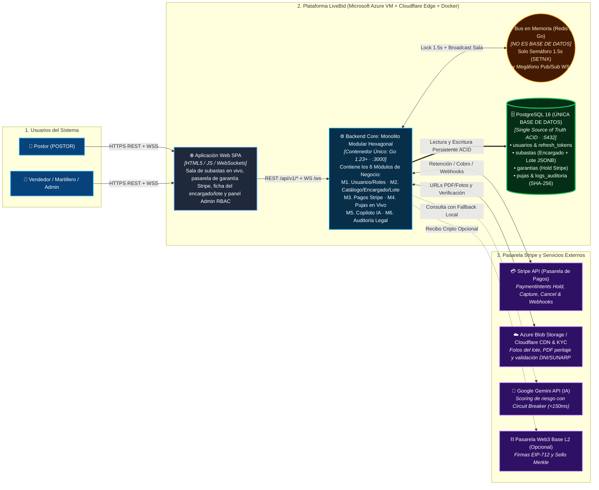

# Nivel 2 · Diagrama de contenedores — LiveBid

> **Proyecto:** LiveBid — Plataforma de Subastas en Tiempo Real  
> **Modelo:** C4 · Nivel 2 de 4 · **Versión:** 3.1 (Monolito Modular Go + 1 Sola Base de Datos PostgreSQL 16 + Pasarela Stripe & Servicios Externos)  
> **Estándar:** Software Design Description (SDD)

---

## 1. Objetivo

Descomponer el sistema **LiveBid** en sus contenedores ejecutables dejando **100% claro para el desarrollo continuo** que:
1. **PostgreSQL 16 es la ÚNICA Base de Datos del sistema (Single Source of Truth ACID)**.
2. **Redis NO es una segunda base de datos**: es únicamente un **bus efímero en memoria** (semáforo de `1.5s` y difusión WebSocket) que incluso puede reemplazarse en desarrollo local por memoria nativa de Go.
3. **Stripe API**, **Azure Blob Storage / Cloudflare CDN & KYC**, **Google Gemini IA** y **Web3** se conectan como servicios externos desacoplados, desplegando el clúster sobre **Microsoft Azure + Cloudflare Edge (`HTTPS`/`WSS`)**.

---

## 2. Diagrama de Contenedores (C4 Nivel 2)

---

## 3. Catálogo de Contenedores y Claridad Operativa

| Contenedor (`docker-compose.yml`) | Rol Arquitectónico | ¿Guarda Datos Persistentes? | Explicación para Desarrollo Continuo |
| :--- | :--- | :---: | :--- |
| **`livebid-api-server` (`:3000`)** | **Monolito Modular en Go 1.23+ + SPA Web** | No (Stateless) | Un solo binario que aloja los **6 módulos de negocio** y sirve el frontend. Cero complejidad de múltiples servidores. |
| **`livebid-postgres` (`:5432`)** | **ÚNICA BASE DE DATOS (`PostgreSQL 16`)** | **SÍ (100% ACID)** | Aquí vive toda la información del sistema (`usuarios`, `subastas`, `garantias`, `pujas`, `logs_auditoria`). |
| **`livebid-redis` (`:6379`)** | **Coordinador Efímero en Memoria** | **NO (0% Tablas)** | **No es una segunda base de datos.** Solo actúa como semáforo de `1.5s` durante una puja y canal de avisos en vivo. Si no está presente en local, Go usa memoria interna automáticamente. |
