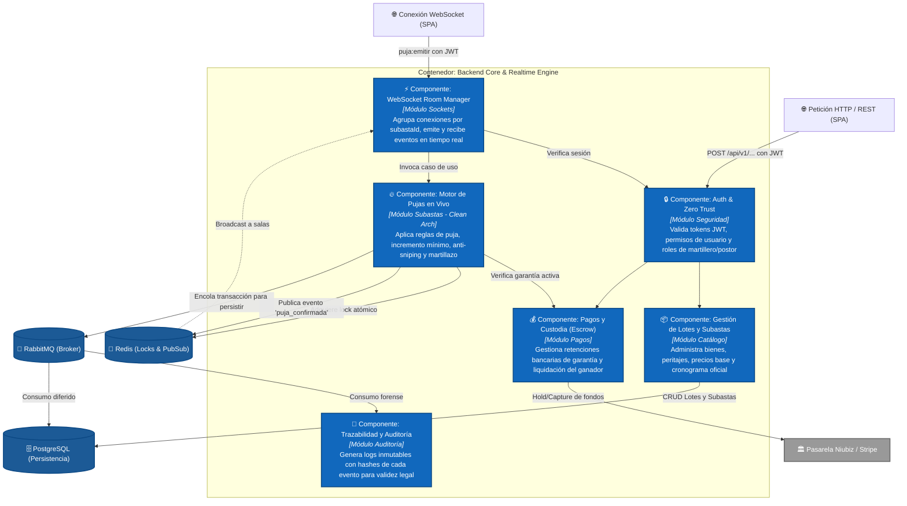

# Nivel 3 · Diagrama de componentes — LiveBid

> **Proyecto:** LiveBid — Plataforma de Subastas en Tiempo Real  
> **Contenedor Detallado:** Core API Backend & Realtime Bid Engine  
> **Modelo:** C4 · Nivel 3 de 4 · **Versión:** 1.0  
> **Estándar:** Software Design Description (SDD)

---

## 1. Objetivo

Abrir los contenedores centrales de backend de LiveBid y mostrar sus **componentes internos**: módulos lógicos del monolito modular, la responsabilidad de cada uno, sus contratos de interfaz y cómo interactúan entre sí y con las bases de datos y servicios externos.

| Aspecto | Descripción |
|---|---|
| **Pregunta que responde** | ¿Cómo se estructuran internamente los módulos del backend y qué interfaces exponen? |
| **Audiencia** | Arquitectos de software, líderes técnicos, desarrolladores de backend |
| **Qué es un componente en C4** | Un conjunto encapsulado de clases o funciones con una interfaz bien definida |
| **Nivel anterior** | `Nivel2-DiagramadeContenedores.md` |
| **Siguiente nivel** | `Nivel4-DiagramadeCodigo.md` |

---

## 2. Diagrama de Componentes (C4 Nivel 3)

---

## 3. Catálogo de Componentes del Backend

| Componente | Responsabilidad | Operaciones Clave | Dependencias |
|---|---|---|---|
| **WebSocket Room Manager** | Gestión del ciclo de vida de los sockets en salas activas. | `unirASala(subastaId)`, `desconectar(socketId)`, `emitirATodos(evento, payload)` | `Auth & Zero Trust`, `Motor de Pujas` |
| **Auth & Zero Trust** | Autenticación basada en tokens JWT con verificación de identidad legal. | `validarToken(jwt)`, `autorizarRol(rol)`, `verificarEstadoKYC(userId)` | `PostgreSQL` |
| **Gestión de Lotes** | Registro de productos, categorías, valores de tasación y lotes de subasta. | `crearLote()`, `programarSubasta()`, `consultarCatalogo()` | `PostgreSQL` |
| **Motor de Pujas (Bid Core)** | Orquestación atómica del martillazo, resolución de ofertas y anti-sniping. | `procesarPuja()`, `iniciarConteoMartillo()`, `declararGanador()` | `Redis`, `RabbitMQ`, `Pagos y Custodia` |
| **Pagos y Custodia (Escrow)** | Retención preventiva de depósitos de garantía antes de permitir pujar. | `retenerGarantia()`, `liberarGarantiasPerdedores()`, `cobrarGanador()` | `Pasarela Niubiz / Stripe`, `PostgreSQL` |
| **Trazabilidad y Auditoría** | Generación de bitácora criptográfica e inmutable de eventos de la subasta. | `registrarEvento(evento, timestamp, hash)`, `emitirActaRemate()` | `PostgreSQL` |

---

## 4. Trazabilidad con Requisitos del Sistema

- **RF-02 (Depósito en Garantía):** Implementado por el componente `Pagos y Custodia (Escrow)` comunicándose con la `Pasarela Niubiz` mediante el patrón Adapter.
- **RF-04 (Procesamiento de Puja en Vivo):** Atendido por `WebSocket Room Manager` $\rightarrow$ `Motor de Pujas` asegurando un tiempo de respuesta P95 $< 200$ ms (EQ-01).
- **RF-05 (Orden Estricto sin Colisiones):** Garantizado por el `Motor de Pujas` utilizando locks distribuidos atómicos en `Redis` (EQ-02).

