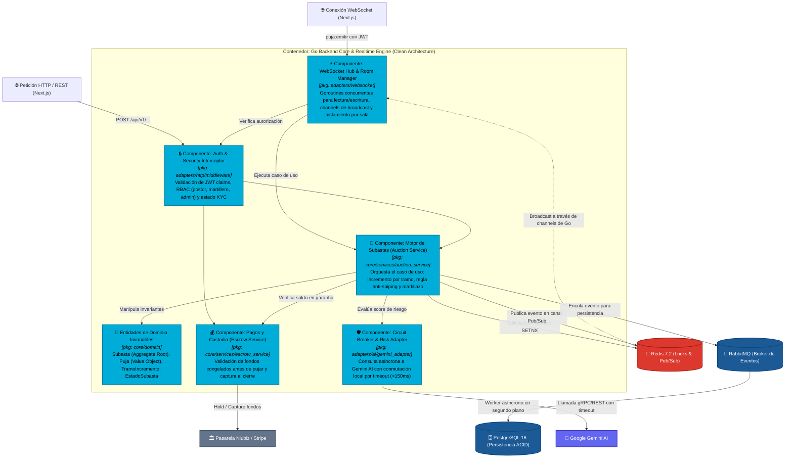

# Nivel 3 · Diagrama de componentes — LiveBid

> **Proyecto:** LiveBid — Plataforma de Subastas en Tiempo Real  
> **Contenedor Detallado:** Go Backend Core & Realtime Engine  
> **Modelo:** C4 · Nivel 3 de 4 · **Versión:** 2.0 (Arquitectura Limpia en Go)  
> **Estándar:** Software Design Description (SDD)

---

## 1. Objetivo

Abrir el contenedor central de backend de LiveBid desarrollado en **Go (Golang)** y detallar sus **componentes internos**: paquetes modulares bajo Clean Architecture, la responsabilidad de cada uno, sus contratos (interfaces idiomáticas de Go) y cómo interactúan mediante Goroutines, Canales y conexiones hacia PostgreSQL, Redis y APIs externas.

| Aspecto | Descripción |
|---|---|
| **Pregunta que responde** | ¿Cómo se estructuran internamente los módulos del backend en Go y qué interfaces/puertos exponen? |
| **Audiencia** | Arquitectos de software, líderes técnicos, desarrolladores de Go y evaluadores de arquitectura |
| **Qué es un componente en C4** | Un paquete o módulo cohesionado en Go con interfaces (`ports`) claramente desacopladas |
| **Nivel anterior** | `Nivel2-DiagramadeContenedores.md` |
| **Siguiente nivel** | `Nivel4-DiagramadeCodigo.md` |

---

## 2. Diagrama de Componentes (C4 Nivel 3 — Go Engine)

---

## 3. Catálogo de Componentes en Go

| Componente | Paquete Go (`package`) | Responsabilidad Principal | Mecanismo de Concurrencia |
|---|---|---|---|
| **WebSocket Hub** | `adapters/websocket` | Administra la conexión bidireccional de cada cliente. Agrupa postores por `subastaID` en mapas protegidos con `sync.RWMutex`. | Goroutine individual por socket (`readPump` y `writePump`) comunicadas vía Canales (`chan []byte`). |
| **Auth & Security** | `adapters/http/middleware` | Decodificación y validación de tokens JWT en el handshake de WebSocket y endpoints REST. Verifica el flag de verificación KYC. | Middleware stateless evaluado en $pprox 0.1$ ms. |
| **Motor de Subastas (Service)** | `core/services` | Implementa el caso de uso `ProcesarPuja`. Invoca las interfaces (`ports`) de bloqueo atómico, validación de reglas en la entidad y difusión de resultados. | Ejecución síncrona dentro del lock distribuido de Redis para garantizar orden estricto. |
| **Entidades de Dominio** | `core/domain` | Estructuras puras (`struct`) sin dependencias externas. Contienen la lógica de negocio: cálculo del incremento mínimo, extensión de tiempo por anti-sniping y validación de estado. | Invariables de memoria sin I/O. |
| **Custodia y Garantías** | `core/services` | Garantiza que un usuario no puje si no tiene un depósito en garantía activo que respalde su oferta. | Interfaz `EscrowPort` desacoplada del proveedor bancario. |
| **Circuit Breaker IA** | `adapters/ai` | Monitorea la latencia y disponibilidad de la API de Gemini. Si Gemini tarda más de 150 ms o falla consecutivamente, abre el circuito y activa una heurística en memoria para no frenar la subasta en vivo. | Goroutine periódica de sondeo y estado atómico (`sync/atomic`). |

---

## 4. Trazabilidad con Requisitos y Drivers Arquitectónicos

- **DA01 — Escalabilidad & DA03 — Rendimiento:** El uso de Goroutines y Canales en el `WebSocket Hub` permite atender más de 10,000 conexiones concurrentes consumiendo menos de 40 MB de RAM.
- **DA02 — Integridad & Orden Verificable:** La coordinación entre `Auction Service` y `Redis Locks` garantiza que dos ofertas simultáneas se resuelvan en orden estricto de llegada al milisegundo (cero colisiones).
- **DA06 — Seguridad y Fraude:** El `Circuit Breaker & Risk Adapter` evalúa patrones anómalos de pujas con **Gemini AI** sin poner en riesgo la disponibilidad de la plataforma en caso de fallos externos.
