# Nivel 3 · Diagrama de componentes — LiveBid

> **Proyecto:** LiveBid — Plataforma de Subastas en Tiempo Real  
> **Contenedor Detallado:** `livebid-api-server` (Go 1.23+ Hexagonal Backend)  
> **Modelo:** C4 · Nivel 3 de 4 · **Versión:** 3.0  
> **Estándar:** Software Design Description (SDD)

---

## 1. Objetivo

Abrir el contenedor principal **`livebid-api-server`** y mostrar todos sus **componentes internos en Go**, cómo se conectan a través de interfaces de dominio (`ports.go`) y cómo integran las capas de **Tiempo Real (`AuctionRoomHub`)**, **RBAC con Caché**, **Web3 (`EIP-712` + `MerkleTree`)** e **IA Exponencial (`MultiModelRouter` + `CircuitBreaker` + `AsyncAnomalyDetector` + `AgentDelegationService`)**.

---

## 2. Diagrama de Componentes (C4 Nivel 3)

```mermaid
graph TD
    classDef handler fill:#1E293B,stroke:#38BDF8,color:#ffffff,stroke-width:2px;
    classDef service fill:#082F49,stroke:#0EA5E9,color:#ffffff,stroke-width:2px;
    classDef domain fill:#14532D,stroke:#22C55E,color:#ffffff,stroke-width:2px;
    classDef adapter fill:#334155,stroke:#94A3B8,color:#ffffff,stroke-width:2px;
    classDef ai fill:#312E81,stroke:#818CF8,color:#ffffff,stroke-width:2px;
    classDef web3 fill:#3B0764,stroke:#C084FC,color:#ffffff,stroke-width:2px;

    subgraph GoContainer["Contenedor: livebid-api-server (Go 1.23+ Hexagonal Architecture)"]
        direction TB

        subgraph DrivingAdapters["Adaptadores Primarios (internal/adapters/handlers & realtime)"]
            AuthH["🔒 AuthHandler & RBAC Middleware<br><i>/auth/*, /admin/users/* (Roles, KYC, Estado)</i>"]:::handler
            AuctionH["🏛️ AuctionHandler<br><i>/subastas/*, /encargado, /detalles-lote, /auditoria-web3</i>"]:::handler
            BidEscrowH["💰 BidHandler & EscrowHandler<br><i>/pujas (Idempotency + EIP-712), /garantias</i>"]:::handler
            AgentAIH["🤖 AgentAIHandler<br><i>/agentes-ia/*, /inteligencia-ia, /admin/ia/modelo</i>"]:::handler
            RoomHub["📡 WebSocketHandler + AuctionRoomHub<br><i>Multiplexación O(1): 1 Suscripción Redis por Sala</i>"]:::handler
        end

        subgraph ApplicationServices["Servicios de Aplicación (internal/core/services)"]
            AuthSvc["AuthService<br><i>Registro, Login, Roles RBAC, KYC</i>"]:::service
            CatalogSvc["AuctionCatalogService<br><i>Ciclo Subasta, EncargadoSubasta, DetallesLote</i>"]:::service
            AuctionSvc["AuctionService<br><i>ProcesarPuja Atómica & CerrarVencidas</i>"]:::service
            EscrowSvc["EscrowService<br><i>Retención y Validación de Garantías</i>"]:::service
            Web3AuditSvc["Web3AuditService<br><i>MerkleRoot, MerkleProof y Recibo On-Chain</i>"]:::service
            AgentDelegationSvc["AgentDelegationService<br><i>Auto-Puja IA con Techo max_cap</i>"]:::service
        end

        subgraph CoreDomain["Núcleo de Dominio Puro (internal/core/domain)"]
            DomainEntities["💎 Entidades e Invariantes<br><i>Subasta, EncargadoSubasta, DetallesLote, Puja, User, MerkleTree, AgentGrant</i>"]:::domain
        end

        subgraph DrivenAdapters["Adaptadores Secundarios (internal/adapters/*)"]
            CachedUserRepo["⚡ CachedUserRepository<br><i>Decorador RAM TTL + Invalidación Reactiva</i>"]:::adapter
            PGRepos["🗄️ Postgres Repositories (pgxpool)<br><i>User, Auction (ListarVencidas), Bid (FOR UPDATE + SHA-256), Escrow</i>"]:::adapter
            RedisAdapters["🧠 RedisLockAdapter & RedisBidNotifier<br><i>SETNX + Lua Unlock + Pub/Sub</i>"]:::adapter
            AIRouterComp["🔀 MultiModelRouter + CircuitBreaker (150ms)<br><i>GeminiRiskAdapter + Fallback Heurístico</i>"]:::ai
            AnomalyComp["🔎 AsyncAnomalyDetector<br><i>Worker Canal: Bot Sniping, Wash Trading, Shill Bidding</i>"]:::ai
            Web3Adapters["⛓️ EIP712Verifier & EVMEscrowAdapter<br><i>Firmas Criptográficas y Liquidación On-Chain</i>"]:::web3
        end
    end

    AuthH --> AuthSvc
    AuctionH --> CatalogSvc
    AuctionH --> Web3AuditSvc
    BidEscrowH --> AuctionSvc
    BidEscrowH --> EscrowSvc
    AgentAIH --> AgentDelegationSvc
    AgentAIH --> AnomalyComp
    AgentAIH --> AIRouterComp
    RoomHub --> RedisAdapters

    AgentDelegationSvc --> AuctionSvc
    AuthSvc & CatalogSvc & AuctionSvc & EscrowSvc & Web3AuditSvc & AgentDelegationSvc --> DomainEntities

    AuthSvc --> CachedUserRepo
    CachedUserRepo --> PGRepos
    CatalogSvc & AuctionSvc & EscrowSvc & Web3AuditSvc --> PGRepos
    AuctionSvc --> RedisAdapters
    AuctionSvc --> AIRouterComp
    AuctionSvc --> AnomalyComp
    AuctionSvc --> Web3Adapters
    Web3AuditSvc --> Web3Adapters
```

---

## 3. Catálogo de Componentes Internos en Go

| Componente | Paquete (`internal/...`) | Responsabilidad Técnica |
|---|---|---|
| **`AuthHandler` + `AuthService`** | `adapters/handlers`, `core/services` | Registro, emisión de JWT/Refresh Tokens, bootstrap de Admin inicial y gestión RBAC (`GET /admin/users`, cambio de rol `POSTOR`/`VENDEDOR`/`MARTILLERO`/`ADMIN`, cambio de estado y aprobación KYC). |
| **`CachedUserRepository`** | `adapters/persistence` | Decorador concurrente (`sync.RWMutex`) sobre `PostgresUserRepository` que resuelve `FindByID` en memoria y purga la entrada instantáneamente ante cambios de rol o estado. |
| **`AuctionHandler` + `AuctionCatalogService`** | `adapters/handlers`, `core/services` | Creación de subastas, carga/actualización del **`EncargadoSubasta`** (martillero responsable, licencia, contacto) y **`DetallesLote`** (categoría, reserva, ubicación, fotos, peritaje), activación, paso a `EN_CONTEO` y cierre. |
| **`AuctionService`** | `core/services` | Orquesta el caso de uso crítico `ProcesarPuja` (Lock Redis $\rightarrow$ Firma EIP-712 $\rightarrow$ Escrow $\rightarrow$ Riesgo IA $\rightarrow$ Reglas Dominio $\rightarrow$ Persistencia Atómica SHA-256 $\rightarrow$ Broadcast + Telemetría) y `CerrarVencidas`. |
| **`AuctionRoomHub`** | `adapters/realtime` | Multiplexor de salas WebSocket que mantiene 1 única suscripción Redis Pub/Sub por subasta activa y distribuye los frames JSON a todos los clientes locales. |
| **`MultiModelRouter` + `CircuitBreaker`** | `adapters/ai` | Permite conmutar modelos de IA en caliente y protege la latencia de la puja con un corte a los $150\text{ ms}$ y heurística local de respaldo. |
| **`AsyncAnomalyDetector`** | `adapters/ai` | Analiza las pujas en una goroutine separada para identificar ráfagas sobrehumanas (*Bot Sniping*), ping-pong colusorio (*Wash Trading*) e inflado artificial (*Shill Bidding*). |
| **`AgentDelegationService`** | `core/services` | Registra mandatos de auto-puja por postor y ejecuta incrementos tácticos respetando el techo presupuestario `max_cap`. |
| **`Web3AuditService` + `EIP712Verifier` + `EVMEscrowAdapter`** | `core/services`, `adapters/web3` | Verifica firmas tipadas EIP-712, calcula la `MerkleRoot` del historial de pujas, genera `MerkleProof` por índice y liquida el colateral en Smart Contract al cierre. |
