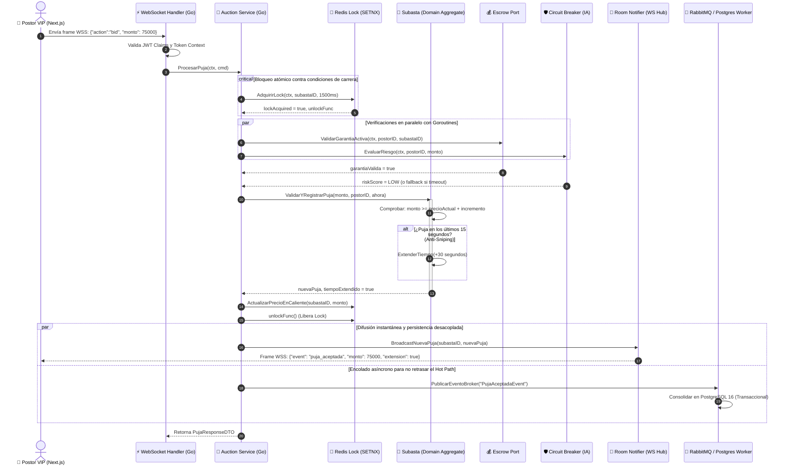

# Nivel 4 · Diagrama de código — LiveBid

> **Proyecto:** LiveBid — Plataforma de Subastas en Tiempo Real  
> **Flujo Detallado:** Caso de Uso Crítico: `ProcesarPujaEnTiempoReal`  
> **Modelo:** C4 · Nivel 4 de 4 · **Lenguaje:** Go (Golang 1.23+) · **Notación:** UML (Clases y Secuencia) · **Versión:** 2.0  
> **Estándar:** Software Design Description (SDD)

---

## 1. Objetivo

Mostrar la **organización interna del código fuente en Go**: structs, interfaces idiomáticas, métodos receptores (`receiver methods`), canales y colaboraciones para el flujo más crítico del sistema: la **recepción, validación atómica y adjudicación de una puja en tiempo real**.

| Aspecto | Descripción |
|---|---|
| **Pregunta que responde** | ¿Qué structs e interfaces en Go implementan el caso de uso crítico y cómo interactúan respetando Clean Architecture? |
| **Audiencia** | Desarrolladores backend Go, evaluadores de código, líderes técnicos |
| **Por qué solo este flujo** | El nivel 4 en C4 es selectivo y se reserva para la pieza de mayor complejidad e impacto del sistema (el motor de subasta concurrente) |
| **Nivel anterior** | `Nivel3-Diagrama-de-Componentes.md` |

---

## 2. Diagrama de Clases / Estructuras UML (Clean Architecture en Go)

```mermaid
classDiagram
    direction TB

    %% CAPA PRESENTACION
    namespace Presentacion {
        class WebSocketBidHandler {
            -auctionService IAuctionService
            +HandleEmitirPuja(ctx context.Context, client *Client, payload EmitirPujaDTO) error
        }
        class EmitirPujaDTO {
            +SubastaID string
            +Monto float64
            +PostorID string
        }
    }

    %% CAPA APLICACION
    namespace Aplicacion {
        class AuctionService {
            -subastaRepo SubastaRepository
            -lockPort BidLockPort
            -escrowPort PaymentEscrowPort
            -notifierPort RoomNotifierPort
            -riskPort AIRiskPort
            +ProcesarPuja(ctx context.Context, cmd ProcesarPujaCmd) (*PujaResponseDTO, error)
        }
        class ProcesarPujaCmd {
            +SubastaID string
            +Monto float64
            +PostorID string
            +Timestamp time.Time
        }
        class IAuctionService {
            <<interface>>
            +ProcesarPuja(ctx context.Context, cmd ProcesarPujaCmd) (*PujaResponseDTO, error)
        }
    }

    %% CAPA DOMINIO (INTERFACES / PUERTOS)
    namespace Dominio_Puertos {
        class SubastaRepository {
            <<interface>>
            +ObtenerPorID(ctx context.Context, id string) (*Subasta, error)
            +Guardar(ctx context.Context, subasta *Subasta) error
        }
        class BidLockPort {
            <<interface>>
            +AdquirirLock(ctx context.Context, subastaID string, ttl time.Duration) (UnlockFunc, error)
        }
        class PaymentEscrowPort {
            <<interface>>
            +ValidarGarantiaActiva(ctx context.Context, postorID string, subastaID string) (bool, error)
        }
        class RoomNotifierPort {
            <<interface>>
            +BroadcastNuevaPuja(ctx context.Context, subastaID string, puja Puja) error
        }
        class AIRiskPort {
            <<interface>>
            +EvaluarRiesgo(ctx context.Context, postorID string, monto float64) (RiskScore, error)
        }
    }

    %% CAPA DOMINIO (MODELOS)
    namespace Dominio_Modelos {
        class Subasta {
            +ID string
            +PrecioActual float64
            +PostorLiderID string
            +Estado EstadoSubasta
            +FechaCierre time.Time
            +Pujas []Puja
            +ValidarYRegistrarPuja(monto float64, postorID string, ahora time.Time) (*Puja, bool, error)
            +CalcularIncrementoMinimo() float64
            +EsUltimosSegundos(ahora time.Time, umbral time.Duration) bool
            +ExtenderTiempo(extension time.Duration)
        }
        class Puja {
            +ID string
            +SubastaID string
            +PostorID string
            +Monto float64
            +Timestamp time.Time
        }
        class EstadoSubasta {
            <<enumeration>>
            PENDIENTE
            ACTIVA
            EN_CONTEO
            CERRADA
        }
    }

    %% CAPA INFRAESTRUCTURA (ADAPTADORES)
    namespace Infraestructura {
        class RedisLockAdapter {
            -rdb *redis.Client
            +AdquirirLock(ctx context.Context, subastaID string, ttl time.Duration) (UnlockFunc, error)
        }
        class PostgresSubastaRepo {
            -db *pgxpool.Pool
            +ObtenerPorID(ctx context.Context, id string) (*Subasta, error)
            +Guardar(ctx context.Context, subasta *Subasta) error
        }
        class GeminiCircuitBreakerAdapter {
            -client *genai.Client
            -state atomic.Int32
            +EvaluarRiesgo(ctx context.Context, postorID string, monto float64) (RiskScore, error)
        }
        class WebSocketRoomAdapter {
            -hub *Hub
            +BroadcastNuevaPuja(ctx context.Context, subastaID string, puja Puja) error
        }
    }

    %% RELACIONES
    WebSocketBidHandler --> IAuctionService : invoca
    AuctionService ..|> IAuctionService : implementa
    AuctionService --> SubastaRepository : usa
    AuctionService --> BidLockPort : usa
    AuctionService --> PaymentEscrowPort : usa
    AuctionService --> RoomNotifierPort : usa
    AuctionService --> AIRiskPort : usa
    AuctionService --> Subasta : manipula
    Subasta *-- Puja : contiene

    RedisLockAdapter ..|> BidLockPort : implementa
    PostgresSubastaRepo ..|> SubastaRepository : implementa
    GeminiCircuitBreakerAdapter ..|> AIRiskPort : implementa
    WebSocketRoomAdapter ..|> RoomNotifierPort : implementa
```

---

## 3. Diagrama de Secuencia: Flujo Crítico de Concurrencia en Go

Este diagrama muestra cómo se ejecutan las Goroutines y el contexto de Go (`context.Context`) protegiendo el tiempo real contra cuellos de botella:

---

## 4. Ventajas de Go en este flujo

1. **Zero Allocations & Tipado Estricto:** Al recibir miles de mensajes JSON por segundo, el parser de Go (`json.Unmarshal` o `fastjson`) y el paso por puntero de structs (`*Subasta`) generan una recolección de basura (*Garbage Collection*) casi nula.
2. **Context Cancellation (`context.WithTimeout`):** Si cualquier llamada externa (como la API de IA o un lock de Redis) tarda más de 200 ms, Go cancela automáticamente la operación evitando que una conexión se quede colgada.
3. **Persistencia asíncrona no bloqueante:** PostgreSQL escribe a su propio ritmo mediante workers que leen la cola, mientras que los postores reciben las actualizaciones en menos de 20 milisegundos gracias a Redis y Go WebSockets.
