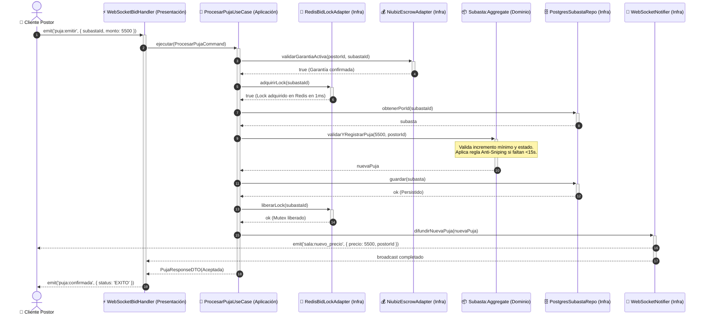

# Nivel 4 · Diagrama de código — LiveBid

> **Proyecto:** LiveBid — Plataforma de Subastas en Tiempo Real  
> **Flujo Detallado:** Caso de Uso Crítico: `ProcesarPujaEnTiempoReal`  
> **Modelo:** C4 · Nivel 4 de 4 · **Notación:** UML (Clases y Secuencia) · **Versión:** 1.0  
> **Estándar:** Software Design Description (SDD)

---

## 1. Objetivo

Mostrar la **organización interna del código fuente**: clases, interfaces, métodos y colaboraciones para el flujo más crítico del sistema: la **recepción, validación atómica y adjudicación de una puja en tiempo real**.

| Aspecto | Descripción |
|---|---|
| **Pregunta que responde** | ¿Qué clases concretas implementan el caso de uso crítico y cómo interactúan respetando Clean Architecture? |
| **Audiencia** | Desarrolladores backend, evaluadores de código, líderes técnicos |
| **Por qué solo este flujo** | El nivel 4 en C4 es selectivo y se reserva para la pieza de mayor complejidad e impacto del sistema (el motor de subasta) |
| **Nivel anterior** | `Nivel3-Diagrama-de-Componentes.md` |

---

## 2. Diagrama de Clases UML (Clean Architecture)

```mermaid
classDiagram
    direction TB

    %% CAPA PRESENTACION
    namespace Presentacion {
        class WebSocketBidHandler {
            -procesarPujaUseCase: ProcesarPujaUseCase
            +onEmitirPuja(clientSocket: Socket, payload: EmitirPujaDTO) void
        }
        class EmitirPujaDTO {
            +subastaId: string
            +monto: number
            +postorId: string
        }
    }

    %% CAPA APLICACION
    namespace Aplicacion {
        class ProcesarPujaUseCase {
            -subastaRepo: ISubastaRepository
            -lockPort: IBidLockPort
            -escrowPort: IPaymentEscrowPort
            -notifierPort: IRoomNotifierPort
            +ejecutar(cmd: ProcesarPujaCommand) Promise~PujaResponseDTO~
        }
        class ProcesarPujaCommand {
            +subastaId: string
            +monto: number
            +postorId: string
            +timestampLlegada: Date
        }
    }

    %% CAPA DOMINIO
    namespace Dominio {
        class Subasta {
            -id: string
            -precioActual: number
            -incrementoMinimo: number
            -estado: EstadoSubasta
            -pujas: List~Puja~
            -finProgramado: Date
            +validarYRegistrarPuja(monto: number, postorId: string) Puja
            +extenderAntiSniping(segundos: number) void
            +esActiva() boolean
        }
        class Puja {
            <<Value Object>>
            +id: string
            +subastaId: string
            +monto: number
            +postorId: string
            +timestamp: Date
            +correlativo: number
        }
        class ISubastaRepository {
            <<interface>>
            +obtenerPorId(id: string) Promise~Subasta~
            +guardar(subasta: Subasta) Promise~void~
        }
        class IBidLockPort {
            <<interface>>
            +adquirirLock(subastaId: string) Promise~boolean~
            +liberarLock(subastaId: string) Promise~void~
        }
        class IPaymentEscrowPort {
            <<interface>>
            +validarGarantiaActiva(postorId: string, subastaId: string) Promise~boolean~
        }
        class IRoomNotifierPort {
            <<interface>>
            +difundirNuevaPuja(puja: Puja) Promise~void~
        }
    }

    %% CAPA INFRAESTRUCTURA
    namespace Infraestructura {
        class RedisBidLockAdapter {
            -redisClient: Redis
            +adquirirLock(subastaId: string) Promise~boolean~
            +liberarLock(subastaId: string) Promise~void~
        }
        class PostgresSubastaRepository {
            -db: PgPool
            +obtenerPorId(id: string) Promise~Subasta~
            +guardar(subasta: Subasta) Promise~void~
        }
        class WebSocketRoomNotifier {
            -ioServer: Server
            -redisPub: Redis
            +difundirNuevaPuja(puja: Puja) Promise~void~
        }
        class NiubizEscrowAdapter {
            -httpClient: AxiosInstance
            +validarGarantiaActiva(postorId: string, subastaId: string) Promise~boolean~
        }
    }

    WebSocketBidHandler --> ProcesarPujaUseCase
    WebSocketBidHandler ..> EmitirPujaDTO

    ProcesarPujaUseCase ..> ProcesarPujaCommand
    ProcesarPujaUseCase --> Subasta
    ProcesarPujaUseCase --> ISubastaRepository
    ProcesarPujaUseCase --> IBidLockPort
    ProcesarPujaUseCase --> IPaymentEscrowPort
    ProcesarPujaUseCase --> IRoomNotifierPort

    Subasta *-- Puja

    RedisBidLockAdapter ..|> IBidLockPort
    PostgresSubastaRepository ..|> ISubastaRepository
    WebSocketRoomNotifier ..|> IRoomNotifierPort
    NiubizEscrowAdapter ..|> IPaymentEscrowPort
```

---

## 3. Diagrama de Secuencia UML: Procesamiento de una Puja

Muestra la interacción milisegundo a milisegundo entre las 4 capas del sistema:

---

## 4. Descripción de Clases Clave

| Clase | Capa | Rol y Responsabilidad |
|---|---|---|
| `WebSocketBidHandler` | Presentación | Desempaqueta el mensaje de la conexión Socket.io, verifica la sesión JWT y llama al caso de uso. |
| `ProcesarPujaUseCase` | Aplicación | Orquesta los pasos del algoritmo de subasta. No conoce librerías web ni SQL; solo puertos. |
| `Subasta` | Dominio | Raíz de agregado que encapsula las invariantes de negocio (precio base, incremento, anti-sniping). |
| `Puja` | Dominio | Objeto de valor inmutable con el importe, timestamp oficial y correlationId. |
| `RedisBidLockAdapter` | Infraestructura | Ejecuta scripts Lua en Redis para garantizar atomicidad estricta y evitar condiciones de carrera. |
| `NiubizEscrowAdapter` | Infraestructura | Verifica contra la pasarela bancaria que el postor tenga fondos congelados para respaldar su oferta. |

