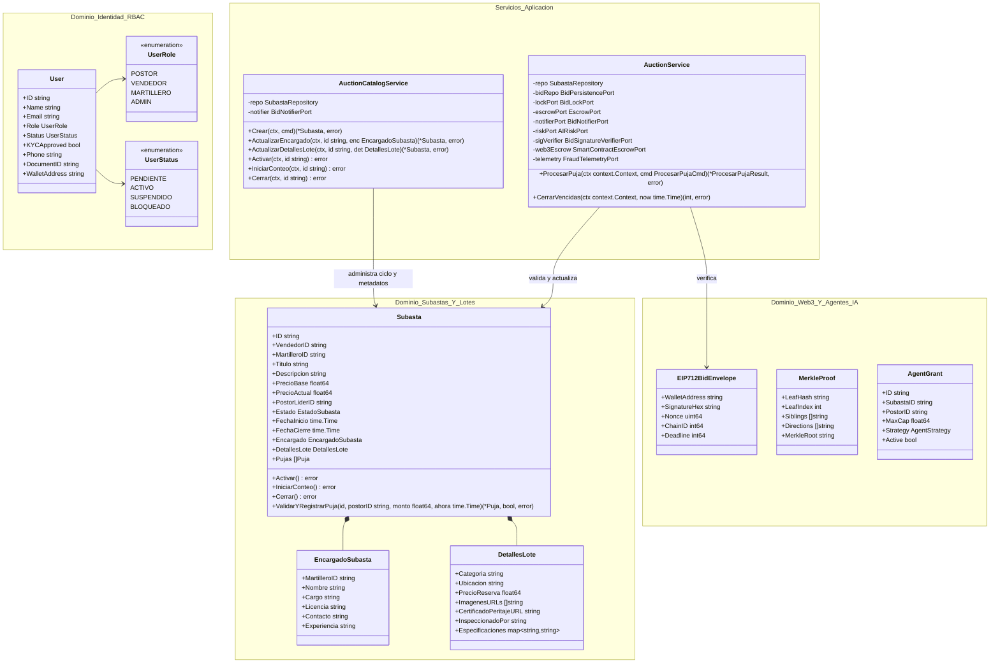
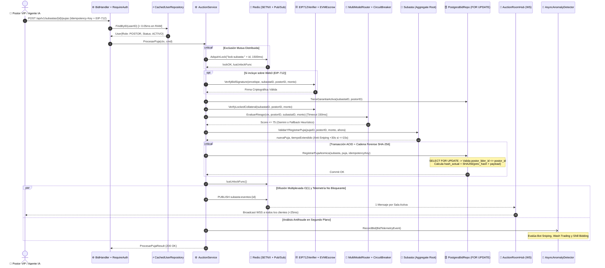

# Nivel 4 · Diagrama de código — LiveBid

> **Proyecto:** LiveBid — Plataforma de Subastas en Tiempo Real  
> **Flujos Detallados:** `ProcesarPuja` (Hot Path + Web3 + IA) y Gestión de `Subasta` (`EncargadoSubasta` + `DetallesLote` + RBAC)  
> **Modelo:** C4 · Nivel 4 de 4 · **Lenguaje:** Go 1.23+ · **Notación:** UML (Clases y Secuencia) · **Versión:** 3.0

---

## 1. Objetivo

Documentar a nivel de **código fuente en Go** los `structs`, interfaces (`ports.go`), firmas de métodos y diagramas de secuencia que implementan la lógica crítica del sistema.

---

## 2. Diagrama de Clases / Estructuras UML (Go 1.23+ Hexagonal)

---

## 3. Diagrama de Secuencia: Flujo Completo de Puja Atómica + Web3 + IA Exponencial

