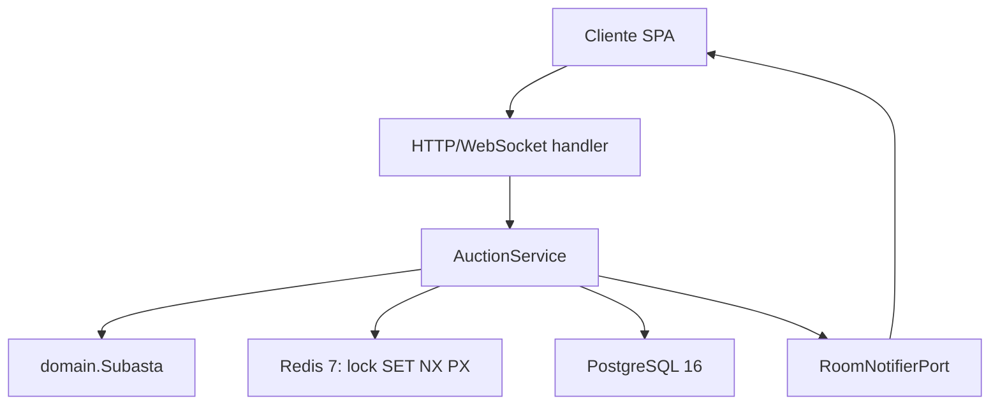

# Plan Técnico: Motor de Pujas en Tiempo Real

> **Feature ID:** `001-realtime-bid-engine`  
> **Implementación objetivo:** Go 1.23+ · Clean/Hexagonal Architecture
> **Estado:** Diseño parcialmente implementado; adaptadores externos pendientes

## 1. Arquitectura y flujo

El camino caliente recibe la puja, valida identidad y garantía, adquiere un
lock Redis, ejecuta las reglas del agregado y publica el resultado. La
persistencia definitiva y la auditoría se realizan con PostgreSQL; RabbitMQ se
incorporará cuando se implemente el worker asíncrono.



La implementación actual del caso de uso está en
`tecnologia/livebid-backend/internal/core/services/auction_service.go`; los
puertos están en `internal/core/domain/ports.go`.

## 2. Contrato de aplicación

```go
type ProcesarPujaCmd struct {
    PujaID    string
    SubastaID string
    PostorID  string
    Monto     float64
    Timestamp time.Time
}

type PujaResponseDTO struct {
    SubastaID       string
    PujaID          string
    PostorLiderID   string
    PrecioActual    float64
    TiempoExtendido bool
    FechaCierre     time.Time
    Estado          domain.EstadoSubasta
}
```

El timestamp oficial lo asigna el servidor. El identificador del postor debe
provenir del contexto autenticado y no de un campo confiable enviado por el
cliente.

## 3. Puertos de dominio

```go
type BidLockPort interface {
    AdquirirLock(ctx context.Context, subastaID string, ttl time.Duration) (UnlockFunc, error)
}

type SubastaRepository interface {
    ObtenerPorID(ctx context.Context, id string) (*Subasta, error)
    Guardar(ctx context.Context, subasta *Subasta) error
}

type PaymentEscrowPort interface {
    ValidarGarantiaActiva(ctx context.Context, postorID, subastaID string) (bool, error)
}

type RoomNotifierPort interface {
    BroadcastNuevaPuja(ctx context.Context, subastaID string, puja Puja, extendida bool) error
}
```

## 4. Lock Redis

El adaptador de producción debe ejecutar:

```text
SET lock:subasta:{subastaID} {requestID} NX PX 1500
```

Si Redis devuelve `nil`, se devuelve un error de colisión. La liberación debe
usar un script Lua que compare `requestID` antes de eliminar la clave. El
`LocalLockAdapter` actual es solo un adaptador de desarrollo y no certifica
concurrencia distribuida.

## 5. Reglas de dominio

`domain.Subasta.ValidarYRegistrarPuja` valida estado, postor líder, incremento
mínimo y anti-sniping. En los últimos 15 segundos agrega 30 segundos al cierre.
La puja aceptada se persiste y se notifica después de aplicar el agregado.

## 6. Verificación

- Unitarias Go para dominio y `AuctionService`.
- Pruebas concurrentes con Redis real: una aceptación por incremento.
- Pruebas de integración con PostgreSQL y el adaptador de notificación.
- Pruebas de contrato para errores HTTP/WebSocket.
- Pruebas de latencia contra los umbrales de la constitución.

Las suites TypeScript del boilerplate son referencia histórica y no certifican
el backend Go.
