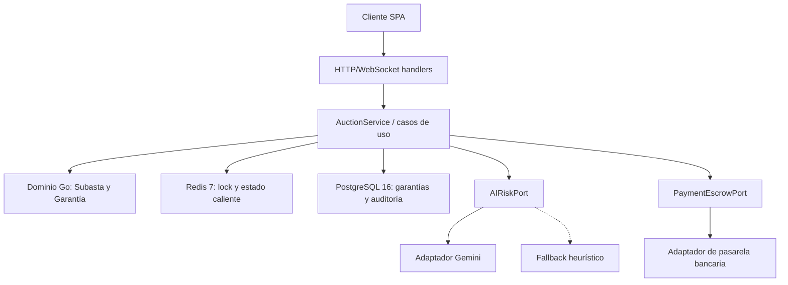
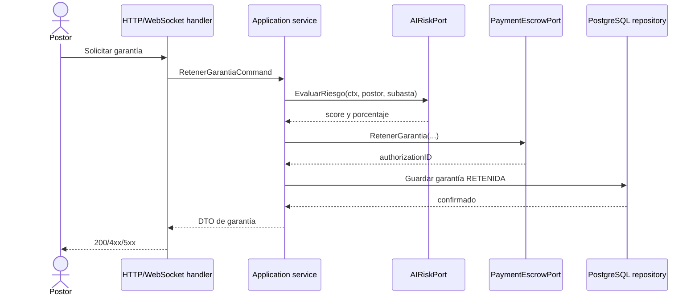

# Plan Técnico: Billetera de Custodia (Escrow) y Evaluación de Riesgo con IA

> **Feature ID:** `002-escrow-wallet-ai`  
> **Fase:** Planificación Técnica (SDD)
> **Implementación objetivo:** Go 1.23+ · Clean/Hexagonal Architecture
> **Estado:** Diseño alineado; adaptadores externos pendientes de integración

Este plan describe la implementación real del backend Go. Los dobles de prueba
se limitan a las pruebas unitarias; Redis, PostgreSQL, el proveedor de pagos y
el proveedor de IA deben conectarse mediante adaptadores de infraestructura.

## 1. Arquitectura de componentes



La dependencia del dominio apunta hacia adentro:

```text
handlers -> services -> domain <- adapters
```

Los puertos actualmente definidos están en
`tecnologia/livebid-backend/internal/core/domain/ports.go`:

- `SubastaRepository`
- `BidLockPort`
- `PaymentEscrowPort`
- `RoomNotifierPort`
- `AIRiskPort`

## 2. Modelo de dominio y contratos Go

La entidad `Subasta` vive en
`tecnologia/livebid-backend/internal/core/domain/auction.go` y concentra las
reglas de estado, incremento mínimo y anti-sniping. La entidad `Garantia`
deberá conservar sus transiciones:

```text
RETENIDA -> CAPTURADA_COBRO
RETENIDA -> LIBERADA
```

El puerto de pagos debe evolucionar para representar operaciones idempotentes
de retención, captura y liberación, conservando el identificador de
autorización bancaria. Las respuestas de infraestructura no deben filtrarse al
dominio.

## 3. Circuit breaker de evaluación de riesgo

El adaptador que implemente `AIRiskPort` debe aplicar estos parámetros de
`spec.md`:

- `CLOSED`: llamadas normales al proveedor de IA.
- `OPEN`: fallback local sin llamar al proveedor.
- `HALF_OPEN`: una llamada de prueba después de 10 segundos.
- Apertura después de **3 fallos consecutivos** o timeout de **2 segundos**.
- Fallback determinista: score `75`, garantía estándar del `10%`.

El timeout debe aplicarse con `context.WithTimeout`; no se deben dejar
goroutines o conexiones bloqueadas esperando indefinidamente.

## 4. Persistencia y consistencia

- `PostgresSubastaRepository` y `PostgresGarantiaRepository` implementan los
  puertos de persistencia usando transacciones.
- La retención debe ser idempotente por `(subasta_id, postor_id)` y evitar
  garantías duplicadas.
- La liquidación debe capturar al ganador y liberar a los perdedores dentro de
  una operación coordinada, registrando cada resultado en auditoría.
- Los errores del proveedor de pagos deben conservarse como errores explícitos;
  no se deben convertir en respuestas exitosas.

## 5. Integración de pagos

`PaymentEscrowPort` será implementado por un adaptador concreto del proveedor
seleccionado. Las credenciales y URLs se obtendrán desde configuración del
entorno, nunca desde el dominio ni desde el código fuente.

El adaptador debe:

1. Crear una retención con una clave idempotente.
2. Devolver el identificador de autorización.
3. Capturar únicamente una garantía en estado `RETENIDA`.
4. Liberar únicamente garantías en estado `RETENIDA`.
5. Traducir códigos del proveedor a errores de infraestructura tipados.

## 6. API y flujo de ejecución



Los handlers deberán validar el payload y mapear errores de dominio e
infraestructura a códigos HTTP definidos en `spec.md`. La identidad del
postor debe provenir del contexto autenticado, no de un campo confiable del
payload.

## 7. Verificación

La cobertura se divide en:

1. **Unitarias:** entidad, transiciones, cálculo de garantía y circuit breaker,
   usando dobles únicamente en los puertos.
2. **Integración:** PostgreSQL, Redis y proveedor de pagos sandbox.
3. **Contrato:** respuestas HTTP/WebSocket y errores públicos.
4. **Resiliencia:** timeout, tres fallos consecutivos, recuperación
   `HALF_OPEN` e idempotencia.

La certificación de la feature solo podrá marcarse como completa cuando las
pruebas de integración con los servicios reales o sandbox pasen. Las pruebas
del antiguo boilerplate TypeScript quedan como referencia histórica y no son
la evidencia de certificación del backend Go.
