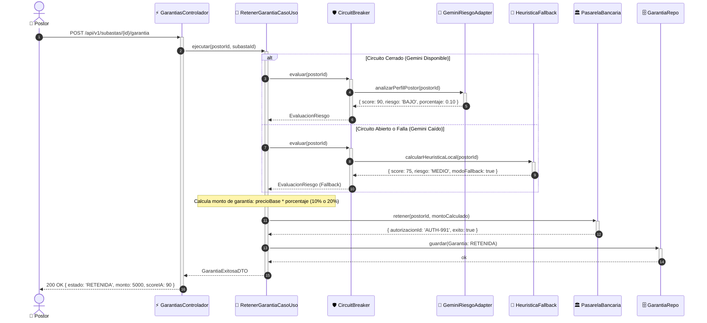

# Plan Técnico: Billetera de Custodia (Escrow) y Evaluación de Riesgo con IA

> **Feature ID:** `002-escrow-wallet-ai`  
> **Fase:** Planificación Técnica (SDD) · **Basado en:** `spec.md`  
> **Patrones:** Clean Architecture, Adapter, Circuit Breaker, Strategy

---

## 1. Arquitectura de Componentes del Feature

```mermaid
graph TD
    Client["📱 Postor (SPA)"]
    Controller["⚡ GarantiasControlador"]
    UCRetener["🎯 RetenerGarantiaCasoUso"]
    UCLiquidar["🎯 LiquidarSubastaCasoUso"]
    
    CircuitBreaker["🛡️ CircuitBreakerInterceptor"]
    AIAgent["🤖 GeminiRiesgoAdapter (API Gemini)"]
    AIFallback["🧠 HeuristicaLocalFallback"]
    
    PortRepo["🗄️ ICustodiaGarantiaRepository"]
    PortBank["🏛️ IPasarelaBancariaPort (Niubiz/Stripe)"]

    Client -->|1. Solicita ingreso a sala| Controller
    Controller -->|2. Ejecuta caso de uso| UCRetener
    
    UCRetener -->|3. Evalúa riesgo con IA| CircuitBreaker
    CircuitBreaker -->|Modo Normal (CLOSED)| AIAgent
    CircuitBreaker -.->|Falla o Timeout (OPEN)| AIFallback
    
    UCRetener -->|4. Retiene fondos ajustados| PortBank
    UCRetener -->|5. Guarda entidad Garantia| PortRepo

    Controller -->|Al adjudicar remate| UCLiquidar
    UCLiquidar -->|Captura fondos del ganador| PortBank
    UCLiquidar -->|Libera fondos de perdedores| PortBank
    UCLiquidar -->|Actualiza estados| PortRepo
```

---

## 2. Implementación del Patrón Circuit Breaker para la IA

Para responder a la pregunta de evaluación: *"¿Si cae Gemini estás preparados?"*:

### Estados del Circuit Breaker
1. **CLOSED (Cerrado - Normal):** Las peticiones fluyen directamente hacia la API de Gemini. Si una llamada tiene éxito, el contador de fallos se reinicia.
2. **OPEN (Abierto - Fallback Activo):** Si ocurren **3 fallos consecutivos** o la API no responde en $< 2,000$ ms, el circuito se abre de inmediato. Las llamadas ya no viajan a Gemini (evitando saturar el servidor con esperas infinitas) y son atendidas instantáneamente por el `HeuristicaLocalFallback`.
3. **HALF_OPEN (Semi-abierto - Prueba de Salud):** Tras 10 segundos, se envía una petición de prueba a Gemini. Si responde con éxito, el circuito vuelve a `CLOSED`; si falla, vuelve a `OPEN`.

### Algoritmo del Fallback Local Heurístico
```typescript
interface EvaluacionRiesgoIA {
  score: number;             // 0 a 100
  nivelRiesgo: 'BAJO' | 'MEDIO' | 'ALTO';
  porcentajeGarantia: number; // 0.10 ó 0.20
  justificacion: string;
  modoFallbackActivado: boolean;
}
```

---

## 3. Modelo de Entidades y Puertos en Dominio

### Entidad `Garantia`
```typescript
export const EstadoGarantia = {
  RETENIDA: 'RETENIDA',
  CAPTURADA_COBRO: 'CAPTURADA_COBRO',
  LIBERADA: 'LIBERADA'
} as const;

export type EstadoGarantia = typeof EstadoGarantia[keyof typeof EstadoGarantia];

export class Garantia {
  public readonly id: string;
  public readonly subastaId: string;
  public readonly postorId: string;
  public readonly montoRetenido: number;
  public readonly autorizacionBancariaId: string;
  public estado: EstadoGarantia;
  public readonly scoreConfianzaIA: number;
  public readonly fechaRetencion: Date;

  constructor(...) { ... }

  public capturar(): void {
    if (this.estado !== EstadoGarantia.RETENIDA) throw new Error(...);
    this.estado = EstadoGarantia.CAPTURADA_COBRO;
  }

  public liberar(): void {
    if (this.estado !== EstadoGarantia.RETENIDA) throw new Error(...);
    this.estado = EstadoGarantia.LIBERADA;
  }
}
```

### Contratos de Puertos (Interfaces de Dominio)
```typescript
export interface IAgenteRiesgoPort {
  evaluarPostor(postorId: string, subastaId: string): Promise<EvaluacionRiesgoIA>;
}

export interface IPasarelaBancariaPort {
  retener(postorId: string, monto: number): Promise<{ autorizacionId: string; exito: boolean }>;
  capturar(autorizacionId: string): Promise<boolean>;
  liberar(autorizacionId: string): Promise<boolean>;
}

export interface ICustodiaGarantiaRepository {
  obtenerGarantia(postorId: string, subastaId: string): Promise<Garantia | null>;
  obtenerPorSubasta(subastaId: string): Promise<Garantia[]>;
  guardar(garantia: Garantia): Promise<void>;
}
```

---

## 4. Diagrama de Secuencia: Retención con Evaluación de IA y Circuit Breaker



