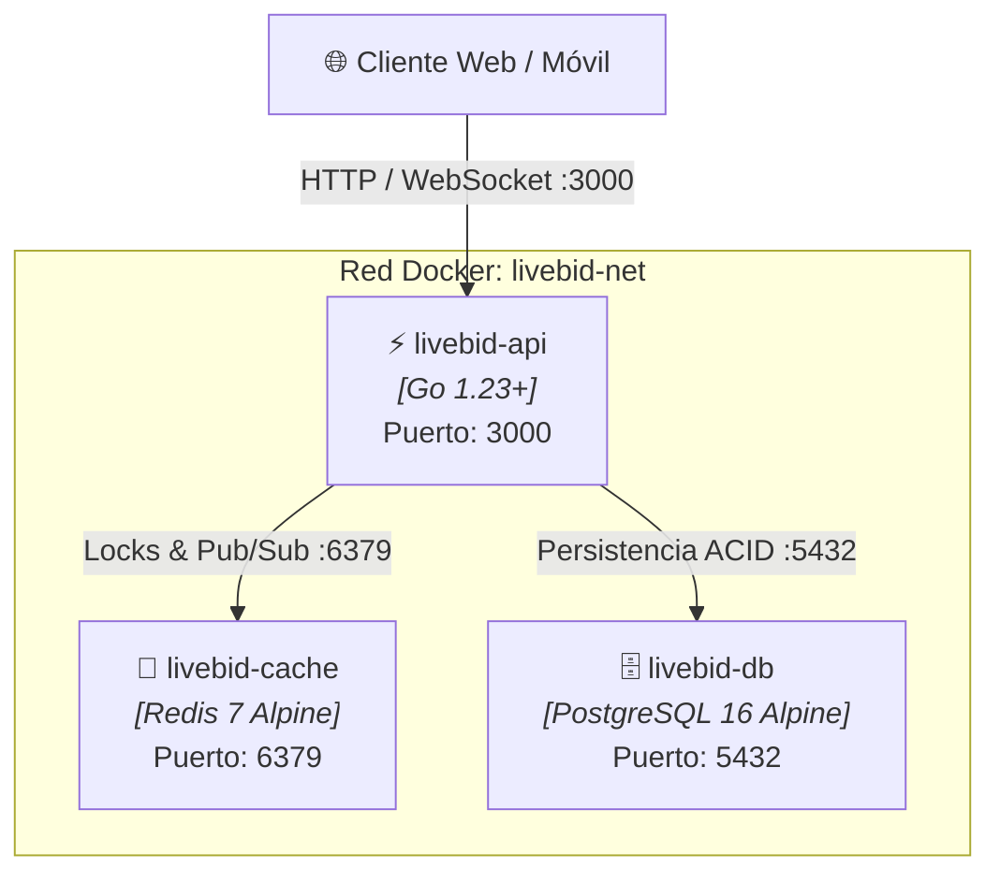

# Plan Técnico: Runtime del Servidor, Orquestación y Entorno Docker

> **Feature ID:** `003-server-runtime-docker`  
> **Fase:** Planificación Técnica (SDD) · **Basado en:** `spec.md`  
> **Tecnologías:** Docker, Docker Compose, PostgreSQL 16, Redis 7, Go 1.23+
> **Implementación objetivo:** `tecnologia/livebid-backend`

---

## 1. Topología Multi-Contenedor (Docker Compose)



### Servicios en `docker-compose.yml`:
1. **`livebid-db`:** Imagen `postgres:16-alpine`. Expone puerto `5432`. Monta `docker/init.sql` en `/docker-entrypoint-initdb.d/init.sql` para inicialización automática.
2. **`livebid-cache`:** Imagen `redis:7-alpine`. Expone puerto `6379`. Configurado con política de persistencia AOF (`--appendonly yes`).
3. **`livebid-api`:** Contenedor Go para ejecutar `tecnologia/livebid-backend`
   con enlace a `livebid-db` y `livebid-cache`.

---

## 2. Bootstrapping del Servidor (`cmd/server/main.go`)

El archivo `cmd/server/main.go` orquesta el arranque del sistema siguiendo
estrictamente la **Inversión de Dependencias (DIP)**:

```text
Configuración (.env)
       │
       ▼
Adaptadores de Infraestructura (PostgresRepo, RedisLock, GeminiAdapter, CircuitBreaker, BankAdapter)
       │
       ▼
Casos de Uso de Aplicación (RetenerGarantia, ProcesarPuja, LiquidarSubasta)
       │
       ▼
Controladores de Presentación (PujasControlador, GarantiasControlador)
       │
       ▼
Servidor HTTP & Router (/health, /api/v1/subastas/:id/puja, /api/v1/subastas/:id/garantia)
```

---

## 3. Especificación del Esquema DDL Relacional (`docker/init.sql`)

El script de inicialización contiene:
- Tabla `usuarios`: Id, nombre, email, rol (`POSTOR`, `MARTILLERO`, `VENDEDOR`, `ADMIN`).
- Tabla `subastas`: Id, titulo, precio_base, incremento_minimo, precio_actual, estado, fin_programado.
- Tabla `garantias`: Id, subasta_id, postor_id, monto_retenido, autorizacion_bancaria_id, estado, score_ia.
- Tabla `pujas`: Id, subasta_id, postor_id, monto, correlativo, timestamp_oficial, hash_integridad.
- Tabla `logs_auditoria`: Bitácora inmutable con timestamp, tipo de evento y payload JSON.

---

## 4. Endpoints de la API REST

| Método | Ruta | Parámetros / Body | Descripción |
|---|---|---|---|
| `GET` | `/health` | — | Estado operativo, versión y timestamp |
| `GET` | `/api/v1/subastas/:id` | `id` en URL | Consulta estado del lote, precio líder y tiempo restante |
| `POST`| `/api/v1/subastas/:id/garantia` | `{ postorId, precioBase }` | Retiene garantía con evaluación de IA y Circuit Breaker |
| `POST`| `/api/v1/subastas/:id/puja` | `{ postorId, monto }` | Procesa puja atómica con Anti-Sniping |
| `POST`| `/api/v1/subastas/:id/liquidar` | `{ postorGanadorId, montoFinal }` | Adjudicación final: captura al ganador y libera perdedores |
